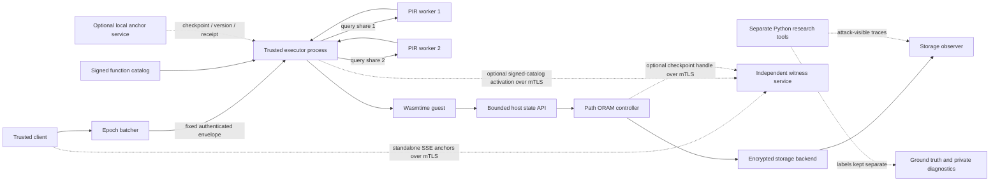

# Oblivion architecture

This file is the short top-level map of the system. The deeper, component-specific specification is in [docs/ARCHITECTURE.md](docs/ARCHITECTURE.md), [docs/PROTOCOL.md](docs/PROTOCOL.md), and the [threat model](docs/THREAT_MODEL.md). For a full narrative walkthrough, see [EXPLANATION.md](EXPLANATION.md).

## System shape

The trusted client submits a fixed-size authenticated envelope through an epoch queue. After epoch release, the executor privately selects a fixed-size function-registry record using two-server XOR PIR, checks that it matches its locally verified catalog, and dispatches an embedded WASM module. The guest's storage calls use a bounded staging layer backed by Path ORAM. The executor returns a fixed class-shaped encrypted response. Research tools consume declared observer-visible traces; labels and private instrumentation are separate inputs used only for scoring and correctness.

The dotted local anchor path is opt-in durability. The separate mTLS witness supports persistent SSE, signed registry catalog clients, and a standalone ORAM checkpoint adapter; the runtime worker can select remote catalog activation through explicit all-or-none environment settings. Remote checkpoint anchoring sends the 88-byte logical handle as a fixed-width 176-character hex field. The handle contains the snapshot key, so the witness can decrypt snapshots it can access and must be trusted with ORAM confidentiality. The runtime worker still uses the local anchor for durable checkpoints and invocation receipts. The dashed research path is not in the request pipeline. None of these paths means hardware isolation.

## Trust and visibility

The adopted model is **TrustedExecutor**: the client and executor are trusted; storage, network, and scheduler are untrusted. The optional mTLS witness is an additional independent trust assumption: its operator must preserve committed anchor state and protect its keys. For ORAM checkpoint operations it also receives the snapshot decryption handle in plaintext and is trusted with checkpoint confidentiality. Any certificate chaining to the configured client CA can access any valid slot; the service has no per-client slot ACL. The prototype models executor isolation with process separation and Wasmtime. A host administrator can inspect process memory, so this prototype has no TEE, secure boot, remote attestation, or protection from host-root compromise.

The two PIR workers each receive one XOR share. Privacy from either server depends on the workers not colluding. Running two processes on one machine is a simulation of that assumption, not evidence that it holds. PIR conceals the selected registry row from one worker; the trusted executor learns the recovered row and selected module.

Public observers can still learn frame timing and sizes, epoch/slot schedules, storage leaves or service events where included in their view, queueing, missed deadlines, resource/cold-start information if instrumented, and availability failures. See the [leakage model](docs/THREAT_MODEL.md) for the exact functions and residual leakage.

## Crates and responsibilities

| Crate | Responsibility |
| --- | --- |
| `oblivion-batcher` | Fixed-shape authenticated endpoints and bounded epoch queues. |
| `oblivion-server` | Process orchestration, end-to-end invocation, registry provisioning, PIR workers, validation, and client oracle. |
| `oblivion-registry` | Fixed 160-byte signed function records and signed catalog validation/activation interfaces. |
| `oblivion-pir` | XOR PIR, fixed database geometry, full scans, and the authenticated generic transport. |
| `oblivion-exec` | Wasmtime validation, execution classes, fuel/memory/host-call bounds, fixed I/O, staged storage schedule. |
| `oblivion-store` | Path ORAM, fixed encrypted buckets, memory/file backends, traces, checkpoints, and restore. |
| `oblivion-anchor` | Local SQLite/Unix-socket compare-and-swap for checkpoint/version state and invocation receipts, plus a bounded mTLS/TCP witness for standalone SSE journal heads, registry catalog version/digest, and Path ORAM checkpoint handles. |
| `oblivion-sse` | Bounded GGM-inspired dynamic encrypted search, with optional persistent client journal adapter. |
| `oblivion-harness` | Rust-side actual-mechanism workloads and separate observer/label files. |
| Python under `research/` | Attack runners, statistical analyses, reproducibility checks, plotting, simulator, and reference evaluations. |

## Timing and storage shape

The current protected execution class targets a 100 ms response boundary. The demo uses an epoch period of 150 ms per enrolled participant and sequential slots. For the public 8-block staged schedule, each successful-backend invocation makes eight logical ORAM reads and eight writes. Each logical access reads and rewrites a root-to-leaf path, so with N=8 leaves and Z=4 it produces 128 bucket-service events per invocation. With 64-byte blocks each encrypted bucket payload is 316 bytes. This is an O(M log N) traffic schedule for public working-set size M; it is not a constant-time schedule at the CPU, operating-system, or network level.

The current documented authenticated invocation envelope is 228 bytes: a 20-byte header, a 192-byte encrypted payload, and a 16-byte authentication tag. Older measurements may use earlier envelope or schedule versions; they remain historical and must not be relabeled as measurements of the current format. Exact field layouts are in [docs/PROTOCOL.md](docs/PROTOCOL.md).

## Durable state and research-only components

Normal process operation is ephemeral. The runtime's optional checkpoint/recovery and signed invocation receipts use the local anchor service; their freshness depends on keeping the anchor database and keys trusted. Restoring an old SQLite backup defeats the version/receipt floor. Persistent SSE journals, signed registry catalogs, and standalone Path ORAM checkpoints can use an mTLS witness to detect rollback of application-side state while the separate witness database remains current. The worker's remote catalog mode is opt-in and fails closed before readiness when configuration, authentication, availability, or CAS reconciliation fails. The checkpoint witness sees and can use the snapshot key from each handle. The single witness is not replicated; restoring its database defeats freshness. Neither service makes arbitrary external side effects atomic.

SSE and the autoscaler are separate research components rather than required steps in the main invocation pipeline. Persistent SSE journal recovery is opt-in and still leaks search equality, result volume, and timing; it is not backward private. Autoscaling is a discrete-event simulation, not a production scaler, and its seeded outputs have no differential-privacy guarantee.

## Read deeper

- Request and storage wire details: [docs/PROTOCOL.md](docs/PROTOCOL.md)
- Failure, recovery, and persistence: [docs/STORAGE_RECOVERY.md](docs/STORAGE_RECOVERY.md), [docs/ANCHOR_SERVICE.md](docs/ANCHOR_SERVICE.md), [docs/INVOCATION_DURABILITY.md](docs/INVOCATION_DURABILITY.md)
- Registry/PIR composition: [docs/REGISTRY_RUNTIME.md](docs/REGISTRY_RUNTIME.md), [docs/PIR_TRANSPORT.md](docs/PIR_TRANSPORT.md)
- Security scope: [docs/THREAT_MODEL.md](docs/THREAT_MODEL.md), [docs/SECURITY_ASSUMPTIONS.md](docs/SECURITY_ASSUMPTIONS.md)
- Evidence and measured limits: [REPORTS.md](REPORTS.md), [docs/EXPERIMENTS.md](docs/EXPERIMENTS.md)
