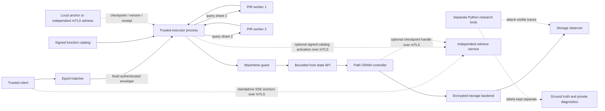

# Oblivion architecture

This file is the short top-level map of the system. The deeper, component-specific specification is in [docs/ARCHITECTURE.md](docs/ARCHITECTURE.md), [docs/PROTOCOL.md](docs/PROTOCOL.md), and the [threat model](docs/THREAT_MODEL.md). For a full narrative walkthrough, see [EXPLANATION.md](EXPLANATION.md).

## System shape

The trusted client submits a fixed-size authenticated envelope through an epoch queue. After epoch release, the executor privately selects a fixed-size function-registry record using two-server XOR PIR, checks that it matches its locally verified catalog, and dispatches an embedded WASM module. The guest's storage calls use a bounded staging layer backed by Path ORAM. The executor returns a fixed class-shaped encrypted response. Research tools consume declared observer-visible traces; labels and private instrumentation are separate inputs used only for scoring and correctness.

Durability is opt-in. The runtime can use either its existing local Unix anchor or the independent mTLS witness for atomic checkpoint-plus-invocation-receipt commits; the same witness also supports persistent SSE, signed registry catalog activation, and standalone ORAM checkpoint anchoring. All remote invocation settings are all-or-none and exclusive with the local socket. Remote checkpoint anchoring sends the 88-byte logical handle as a fixed-width 176-character hex field. The handle contains the snapshot key, so the witness can decrypt snapshots it can access and must be trusted with ORAM confidentiality. The witness does not replicate snapshot files or provide a distributed lease. The dashed research path is not in the request pipeline. None of these paths means hardware isolation.

## Trust and visibility

The adopted model is **TrustedExecutor**: the client and executor are trusted; storage, network, and scheduler are untrusted. The optional mTLS witness is an additional independent trust assumption: its operator must preserve committed anchor state and protect its keys. For ORAM checkpoint operations it also receives the snapshot decryption handle in plaintext and is trusted with checkpoint confidentiality. The witness validates each client certificate against its configured CA and then checks a versioned SHA-256 DER leaf-certificate-to-slot policy before dispatch. Policy changes require restart; quotas and rate limits remain absent. The prototype models executor isolation with process separation and Wasmtime. A host administrator can inspect process memory, so this prototype has no TEE, secure boot, remote attestation, or protection from host-root compromise.

The two PIR workers each receive one XOR share. Privacy from either server depends on the workers not colluding. Running two processes on one machine is a simulation of that assumption, not evidence that it holds. PIR conceals the selected registry row from one worker; the trusted executor learns the recovered row and selected module.

Public observers can still learn frame timing and sizes, epoch/slot schedules, storage leaves or service events where included in their view, queueing, missed deadlines, resource/cold-start information if instrumented, and availability failures. See the [leakage model](docs/THREAT_MODEL.md) for the exact functions and residual leakage.

## Crates and responsibilities

| Crate | Responsibility |
| --- | --- |
| `oblivion-batcher` | Fixed-shape authenticated endpoints and bounded epoch queues. |
| `oblivion-server` | Process orchestration, end-to-end invocation, registry provisioning, PIR workers, validation, and client oracle. |
| `oblivion-registry` | Fixed 160-byte signed function records and signed catalog validation/activation interfaces. |
| `oblivion-pir` | XOR PIR, fixed database geometry, full scans, and the authenticated generic transport. |
| `oblivion-exec` | Wasmtime validation, execution classes, fuel/memory/host-call bounds, fixed I/O, staged storage schedule. |
| `oblivion-store` | Path ORAM, fixed encrypted buckets, memory/file backends, traces, checkpoints, and restore. |
| `oblivion-anchor` | Local SQLite/Unix-socket compare-and-swap for checkpoint/version state and invocation receipts, plus a bounded mTLS/TCP witness for runtime invocation receipts, SSE journal heads, registry catalog version/digest, and Path ORAM checkpoint handles. |
| `oblivion-sse` | Bounded GGM-inspired dynamic encrypted search, with optional persistent client journal adapter. |
| `oblivion-harness` | Rust-side actual-mechanism workloads and separate observer/label files. |
| Python under `research/` | Attack runners, statistical analyses, reproducibility checks, plotting, simulator, and reference evaluations. |

## Timing and storage shape

The default protected execution class targets a 100 ms response boundary; `OBLIVION_EXECUTION_DEADLINE_MS` selects a public class deadline from 2–1000 ms for the pipeline worker. The demo defaults to an epoch period of 150 ms per enrolled participant and sequential slots; it records the configured class and phase fractions. The executor reads its eight-block working set at 5% of the class deadline and commits it at 65%. Each successful-backend invocation makes eight logical ORAM reads and eight writes. Each logical access reads and rewrites a root-to-leaf path, so with N=8 leaves and Z=4 it produces 128 bucket-service events per invocation. With 64-byte blocks each encrypted bucket payload is 316 bytes. This is an O(M log N) traffic schedule for public working-set size M; it is not a constant-time schedule at the CPU, operating-system, or network level.

The current documented authenticated invocation envelope is 228 bytes: a 20-byte header, a 192-byte encrypted payload, and a 16-byte authentication tag. Older measurements may use earlier envelope or schedule versions; they remain historical and must not be relabeled as measurements of the current format. Exact field layouts are in [docs/PROTOCOL.md](docs/PROTOCOL.md).

## Durable state and research-only components

Normal process operation is ephemeral. The runtime's optional checkpoint/recovery and signed invocation receipts can use the local anchor or remote mTLS witness; freshness depends on retaining the corresponding trusted database and keys. Restoring an old database backup defeats the version/receipt floor. Remote invocation configuration requires all six `OBLIVION_INVOCATION_ANCHOR_MTLS_*` values and `OBLIVION_ANCHOR_STATE_DIR`, and cannot be combined with `OBLIVION_ANCHOR_SOCKET`. The worker uses one load-then-finish schedule on receipt hits and misses. A hit returns the saved response and idempotently finishes against the currently loaded checkpoint without writing a new snapshot. An ambiguous finish is reconciled with the exact-response confirmation action. The mTLS witness receives receipt data and the snapshot key handle, and can distinguish receipt hits from misses. The single witness is not replicated, supplies no distributed lease, and does not store executor snapshot files. Neither service makes arbitrary external side effects atomic.

SSE and the autoscaler are separate research components rather than required steps in the main invocation pipeline. Persistent SSE journal recovery is opt-in; its local or single-witness generation CAS records a pending update before returning its request and rejects stale writers, while recovery retries the anchored request. Remote mTLS tests cover stale and barrier-synchronized same-generation writers, but do not establish multi-host scheduling or a transaction shared with the SSE server. Search equality, result volume, and timing remain visible; the scheme is not backward private. Autoscaling is a discrete-event simulation, not a production scaler, and its seeded outputs have no differential-privacy guarantee.

## Read deeper

- Request and storage wire details: [docs/PROTOCOL.md](docs/PROTOCOL.md)
- Failure, recovery, and persistence: [docs/STORAGE_RECOVERY.md](docs/STORAGE_RECOVERY.md), [docs/ANCHOR_SERVICE.md](docs/ANCHOR_SERVICE.md), [docs/INVOCATION_DURABILITY.md](docs/INVOCATION_DURABILITY.md)
- Registry/PIR composition: [docs/REGISTRY_RUNTIME.md](docs/REGISTRY_RUNTIME.md), [docs/PIR_TRANSPORT.md](docs/PIR_TRANSPORT.md)
- Security scope: [docs/THREAT_MODEL.md](docs/THREAT_MODEL.md), [docs/SECURITY_ASSUMPTIONS.md](docs/SECURITY_ASSUMPTIONS.md)
- Evidence and measured limits: [REPORTS.md](REPORTS.md), [docs/EXPERIMENTS.md](docs/EXPERIMENTS.md)
