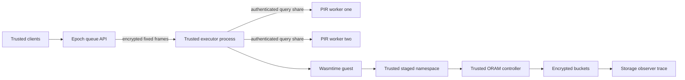

# Architecture

Updated 2026-10-22. The complete supplied roadmap is the specification. [REQUIREMENTS_MATRIX.md](REQUIREMENTS_MATRIX.md) maps implementation, acceptance evidence and outstanding work. The runtime uses the **TrustedExecutor** model, simulating the trust boundary with processes; no hardware TEE or attestation exists.

## Process path

Client and queue APIs share a parent process. The executor is a child process, with two independently instantiated PIR workers. Inherited private pipes provision fresh directional session keys. Kernel protection of these pipes is assumed. A host administrator can read every process and violates the TrustedExecutor assumption.

The demo enrolls one to four clients, runs eight epochs and optionally mixes all five modules. Modules are loaded and validated before readiness. Slots execute sequentially. The epoch period is 150 ms times participant count; the small class deadline is 100 ms per invocation. Public slot order and class are visible.

PIR occurs after epoch release on behalf of the trusted client. Each worker sees one decrypted random query vector, and TCP frames are authenticated/encrypted. At startup the trusted executor either verifies a configured external Ed25519-signed catalog with a pinned public key or uses the development-only ephemeral signer. It provisions the verified 160-byte records to both workers; each recovered row must match the exact local pin before dispatch. External mode moves signing outside the executor, but does not authenticate the public-key-to-publisher binding or provide durable catalog-version anti-rollback or online catalog publication. Process separation does not enforce operator non-collusion, and both workers share one host.

## Components

| Crate / component | Responsibility |
| --- | --- |
| `oblivion-store` | `Backend`, `MemoryBackend`, `FileBackend`, `PathOram`, observer events, trusted checkpoint/restore |
| `oblivion-pir` | Fixed-record XOR query generation/full scans/recovery; plaintext experimental wire and bounded generic `secure` sessions |
| `oblivion-exec` | Wasmtime classes, module validation, fixed I/O, staged scheduled execution, namespaces and unpadded baseline |
| `oblivion-batcher` | Directional authenticated endpoints and bounded fixed epoch queues |
| `oblivion-server` | Process orchestration, verified signed registry rows over encrypted PIR, enrolled slot validation and client oracle |
| `oblivion-registry` | Fixed-size signed registry catalogs/records and rollback-aware version-activation adapter |
| `oblivion-anchor` | SQLite-backed atomic checkpoint/version CAS, signed invocation receipts, and a local Unix-socket service; trusted database/key operator required |
| `oblivion-harness` | Actual component workloads with separate public observations and truth |
| `oblivion-sse` | Append-only encrypted posting index with constrained GGM capabilities; legacy client is ephemeral, optional persistent journal uses local anchor service |
| Python research tools | Attack analysis, trial-cluster confidence intervals, autoscaler event simulation and reference comparisons |

The demo's signed-registry/PIR composition and its key-management limits are
specified in [REGISTRY_RUNTIME.md](REGISTRY_RUNTIME.md); wire bootstrap framing
is in [PROTOCOL.md](PROTOCOL.md).

## Protected execution schedule

The WASM ABI exports linear memory and `invoke(input_ptr,input_len,output_ptr,capacity) -> actual_bytes`, with no WASI. Fuel, memory/table/instance limits, host-call count/charges and epoch interruption bound guest work. They do not preempt a blocked synchronous host call or bound every compiler/host allocation.

Protected execution waits for the public read boundary at one quarter of the class deadline, then reads every block in the public working set through actual ORAM. Guest imports operate on a bounded trusted snapshot. A namespace maps guest addresses to the enrolled user's state or reserved dummy state. Multi-client real/dummy namespaces are disjoint; in the one-client demo the real namespace has seven blocks and the dummy uses block seven.

At half the class deadline, the executor commits every staged block through actual ORAM. Successful guest execution commits staged changes. Trap, invalid-input and fuel failures write the original snapshot, so guest writes before a trap do not persist. All successful-backend paths make M reads and M writes, including non-stateful modules and sanitized dummy/error work. Each logical ORAM operation itself reads and rewrites a complete path. With M=8 and N=8, there are 128 bucket events per invocation, each 316 bytes. This is O(M log N) bandwidth, plus bounded trusted staging memory.

PIR precedes the read phase and is included in the pipeline's start-to-deadline budget. Response publication targets the public deadline. Late PIR, host work, scheduling or storage can miss phase boundaries/deadlines; the API records misses and cannot guarantee constant wall-clock time. Active backend failure may expose partial traces and poisons uncertain ORAM state. Physical commit is not a crash-atomic multi-block transaction. The unpadded baseline intentionally uses direct guest storage behavior.

The trusted driver's publication boundary includes response AEAD and instrumentation preparation: `prepare_scheduled` returns private execution results after the public read/commit phases, then the driver prepares the ciphertext/logs before waiting until the 100 ms response deadline. The standalone `execute_scheduled` API still pads its own return. Client encrypted frames are prepared before public epoch emission, and server slots use epoch-arrival plus slot-index × 100 ms origins so serialization jitter does not accumulate across slots. Driver work overruns and observed publication lateness are distinct private diagnostics; any shared-host timer can wake late.

## Storage and recovery

Path ORAM uses next-power-of-two leaves, Z=4 by default, a trusted position map/stash and fresh remapping on reads and writes. AEAD binds bucket location and trusted version; a trusted O(N) version vector checks live freshness. Controller operations are serialized; unrelated controllers cannot safely share one live tree. Branching and stash containers are not constant-time.

A bounded file backend and full-image checkpoint/restore API exist separately from the memory-backed process demo. Checkpoints authenticate controller keys/maps/stash/versions/counters and all encrypted buckets, publish with file/directory synchronization and return a secret `TrustedCheckpoint` handle. Restore requires the independently protected latest handle, validates the entire image and rekeys/re-encrypts every bucket before returning a controller, preventing reuse of pre-crash bucket nonce domains.

The caller must publish a new handle to a trusted durable anchor before acknowledging durability, retaining the preceding snapshot until that publication commits. `oblivion-anchor` supplies a local SQLite CAS service over a permission-controlled Unix socket and an atomic checkpoint-plus-invocation-receipt API. The invocation API is not wired into the runtime pipeline; there is no end-to-end durable acknowledgment claim. It does not provide remote authentication or anti-rollback protection against database restoration. Checkpoint/recovery are observable full-tree maintenance phases. See [STORAGE_RECOVERY.md](STORAGE_RECOVERY.md), [ANCHOR_SERVICE.md](ANCHOR_SERVICE.md), and [INVOCATION_DURABILITY.md](INVOCATION_DURABILITY.md).

## SSE and later experiments

SSE is a separate bounded client/server component. The legacy client remains ephemeral; opt-in `PersistentClient` stores its state in an encrypted journal and can anchor journal generations through the local Unix `oblivion-anchor` service. A caller must preserve the same opaque slot and service master key across restarts. This supports journal recovery after service-process restart, but restoring an older anchor database defeats freshness. Search equality, volume, timing and historical posting linkage remain visible, and no backward privacy is provided. [SSE_DESIGN.md](SSE_DESIGN.md) gives the exact construction and limits.

The SimplePIR experiment executes the genuine pinned reference with real preprocessing on 10,000 eight-byte records and compares it with actual XOR PIR. It is not the runtime PIR backend. Autoscaling is an independent event simulation with five policies, synthetic workloads, declared observer features and hypothetical prices; it does not provision runtime workers or establish DP.

[SYSTEM_EXPERIMENTS.md](SYSTEM_EXPERIMENTS.md) records the completed final 30-trial A–G/disabled-layer campaign on actual libraries, including the publication-boundary correction and retained earlier negative outcome. The G process oracle separately validates topology. [TRACE_VALIDATION.md](TRACE_VALIDATION.md) records genuine scoped encrypted PIR packet captures; system library payload accounting is not packet capture. Full host/cache/billing observations and broad fault/load/geometry sweeps remain outside those measurements. Historical results identify their executable/source hashes and must not be relabeled measurements of newer code.
