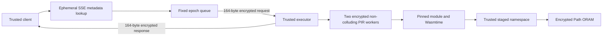

# Oblivion design summary

22 October 2026. A compact design document for the implemented research prototype. The [requirements matrix](REQUIREMENTS_MATRIX.md) retains the complete roadmap. [Research results](RESEARCH_REPORT.md) distinguish completed experiments from pending runs.

## Purpose and trust boundary

Oblivion studies whether private function lookup, oblivious state, constrained execution and cover traffic can reduce serverless invocation inference at an acceptable cost. The implementation is an experimental Rust workspace with real cryptographic/storage/runtime operations and explicit observer traces. Its contribution is integration and measurement; it does not introduce new cryptographic primitives or prove that the composed system hides everything.

The primary model is **TrustedExecutor**: client and executor memory are trusted; network, storage data, batching and scheduling are untrusted. Normal Linux processes simulate this boundary. Wasmtime restricts guests but does not protect executor keys or code from a host administrator. No hardware TEE or attestation is implemented. Two XOR-PIR servers must not collude. Running their workers separately on one host demonstrates protocol separation, not independence of operators.

Assets include function selection, inputs/outputs, state, metadata keywords and invocation activity. Public configuration includes database/tree dimensions, class budgets, enrolled participants and epoch schedule. Endpoints, participation, timing, resources, cold starts, billing and failures may remain visible. The executor necessarily learns the selected code and plaintext state under this model.

## Request path

The process driver enrolls one to four clients. Each has its own invocation endpoint and real/dummy state namespace. Five precompiled modules implement echo, sum, Fibonacci, checksum and a stateful counter. The trusted client checks real outputs against an independent oracle. Slots execute sequentially for eight epochs; the normal small class targets 100 ms and the demo epoch is 150 ms per enrolled participant.

`demo-sse` uses the actual GGM SSE client/server over function-name metadata before constructing each invocation. Authenticated recovered IDs select the function passed into the same PIR/WASM/ORAM path. SSE maps are logical untrusted components in the trusted driver process, not separate deployed services. Search equality, result volume and discovery timing remain visible and outside the padded invocation class. The discovery transcript contains real protocol requests/responses without plaintext names or oracle results. [Runtime integration](RUNTIME_INTEGRATION.md) defines these boundaries.

After batch release, the trusted executor privately retrieves the selected fixed registry record from two separately keyed PIR workers. Each worker scans all records. Recovered records must equal trusted local deployment pins containing function ID, version and exact embedded module digest. This is immutable trusted provisioning, not dynamic signing or a cross-restart version authority.

## Hiding shape with explicit budgets

Invocation envelopes use wire v2 with a public authenticated header and encrypted fixed payload, totaling 228 bytes. Independent directional keys and monotonic epochs prevent tested replay; replies bind to the current request. Fresh session bootstrap uses inherited private pipes. Epoch queues accept one bounded request per enrolled slot and emit fixed capacity. Missing slots become cover and undergo actual dummy work. The expanded payload reserves space for signed idempotency metadata, which is not yet wired into the runtime.

Ordinary guest storage calls can reveal a function through count and timing even when addresses are ORAM-protected. Protected execution therefore reads a public working set through actual ORAM, runs guest host calls against trusted staging and commits the whole set at a public phase. The eight-block small class performs eight reads and eight writes for non-stateful functions, stateful functions and sanitized guest failures. Read/commit boundaries are one quarter/one half of the deadline; PIR precedes the read phase within the same start-to-deadline budget.

Namespaces translate guest addresses into a user's allowed range or reserved dummy state. Failed guest mutations are discarded before physical commit; a write followed by a guest trap leaves original staged contents. Both original and mutable snapshots count toward the staging memory budget. Each physical ORAM operation reads and rewrites an entire randomly remapped path, so the protected schedule costs **O(M log N)** bandwidth for public working-set size M. At the demo geometry it emits 128 bucket events per invocation. This deliberate overhead improves composition clarity without claiming data-oblivious guest instructions.

Fuel, host-call charges/counts, memory/table/instance bounds and epoch interruption limit guest work. They do not cap every JIT/host allocation or preempt a synchronous blocked host call. Scheduler delay, contention and slow storage can miss the public deadline. Active failure can yield partial traces. Uniform successful-backend structure is a bounded engineering property, not a timing-security theorem.

The trusted driver's publication boundary includes response AEAD and instrumentation preparation: `prepare_scheduled` returns private execution results after the public read/commit phases, then the driver prepares the ciphertext/logs before waiting until the 100 ms response deadline. The standalone `execute_scheduled` API still pads its own return. Client encrypted frames are prepared before public epoch emission, and server slots use epoch-arrival plus slot-index × 100 ms origins so serialization jitter does not accumulate across slots. Driver work overruns and observed publication lateness are distinct private diagnostics; any shared-host timer can wake late.

## Storage integrity and recovery

The store implements Path ORAM with Z=4 by default, trusted position map/stash, fresh remapping on reads/writes and whole-bucket AEAD. Associated data binds bucket address and trusted version. A trusted O(N) version vector detects live replay; per-key nonce state must not roll back. Uncertain backend failures poison the controller because partial writes may already have occurred.

Memory and bounded file backends share the same controller. A full checkpoint authenticates configuration, controller keys/maps/stash/versions/counters and every encrypted bucket. Publication synchronizes the file and directory and returns a secret trusted handle. Restore requires the independently protected latest handle, validates the image and rekeys/re-encrypts all buckets before continued use, avoiding restoration of an old encryption nonce domain.

The application must publish a new handle to an external durable freshness anchor before acknowledging durability, retaining the previous immutable snapshot until that transition commits. That service/acknowledgment protocol is not supplied. Replaying both an old handle and snapshot is not prevented. The process demo remains ephemeral, and store checkpoints do not make invocation endpoints durable or exactly once. Maintenance is full-tree, synchronous and observable. [Storage recovery](STORAGE_RECOVERY.md) records the exact failure ordering.

## SSE and independent research components

The bounded append-only SSE component uses HMAC-based constrained GGM covers for exact committed posting prefixes. Client-only payload keys are separate from released capability seeds. Counters advance before exposure; pending retries resend identical ciphertext. Every old search capability may be retained indefinitely. Future leaves remain outside their ranges under stated PRF assumptions, but searches still expose equality, count, posting addresses and timing. The implementation is ephemeral with no key import/restore or backward privacy. Its narrower construction argument must not be mistaken for Diana's complete theorem.

A genuine pinned SimplePIR reference experiment compares real setup/query/answer/recovery with actual XOR PIR on matched eight-byte records. It is not the runtime backend. A separate autoscaler simulator measures five policies using actual queue/readiness/completion events, seeded synthetic arrivals and stated service/cold-start assumptions. It does not provision runtime workers; its prices are hypothetical and noisy scaling has no DP proof.

## Evaluation and remaining claims

Experiments keep observer data, profiling auxiliary knowledge and target truth separate. Independent sessions prevent related-query train/test leakage. Confidence intervals resample independent fitted-model trials rather than correlated queries. Every attack requires a leaky positive control. Measurements declare whether they count local API payloads, algorithm calls, process behavior or simulated events.

Completed evidence includes component frequency/traffic controls, six bounded SSE-facing methods, a uniform nine-adapter attack API, 30-trial eight-class success/error inference, final A–G/disabled-layer evaluation, genuine scoped encrypted PIR packets, actual 100k repeated/uniform ORAM diagnostics, reference PIR runs, autoscaler comparisons, runtime/epoch campaigns and an actual local MP4/terminalcast demo. The final joint G balanced score is 33.40% [32.29,34.51] versus 33.33% chance for the declared feature model. Its earlier corrected-version conditional function score of 54.58% [50.21,59.17] is retained as a possible arrival-coupling negative outcome; mitigations and versions are separate evidence.

The packet classifier lacking a positive control was removed; only packet structural diagnostics are accepted. Bounded likelihood and iterative methods are explicitly not faithful published SAP/IHOP reproductions. Broad loaded/fault/geometry campaigns, presence/intersection, realistic licensed corpora, resource/billing/cache channels and final hosted validation remain work. [The report](RESEARCH_REPORT.md), [system experiments](SYSTEM_EXPERIMENTS.md), [trace validation](TRACE_VALIDATION.md) and [extension notes](EXTENSION_NOTES.md) delimit each artifact.
