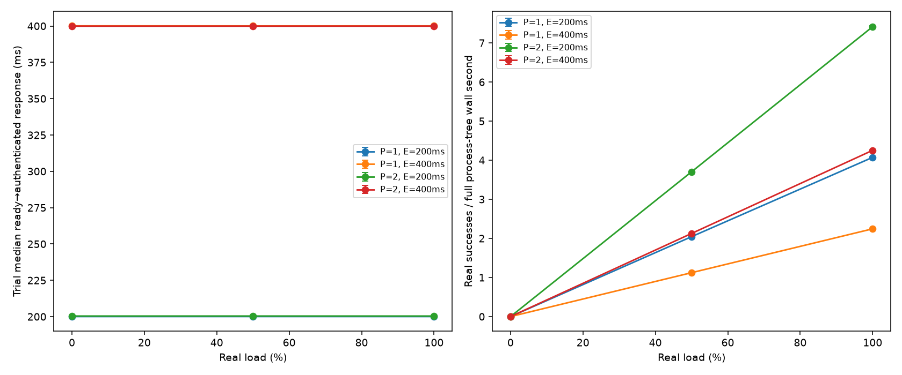
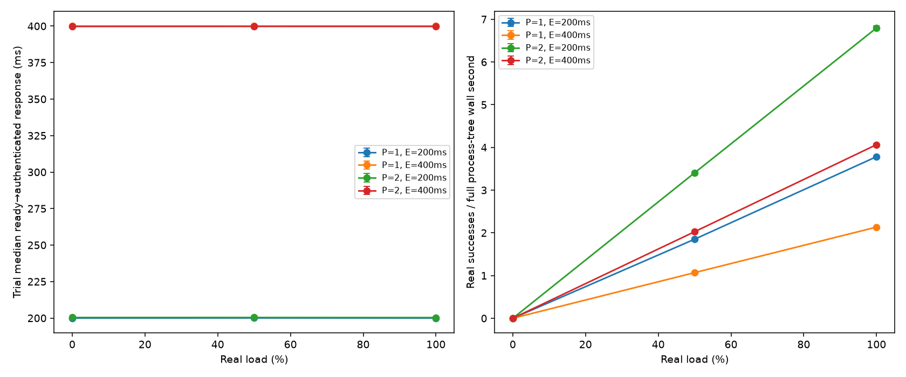

# Runtime epoch, enrollment and dummy-load sweep

The current implementation keeps client preparation timestamps in a separate private file. The retained original `epoch-system-20261023` campaign mixed trusted client timing into a file named `envelope-observer.jsonl`; those historical files must **never be used as attacker input**. Their scoped performance measurements remain historical evidence, but they do not satisfy the current observer/private separation contract. The later [separated campaign](#historical-separated-campaign-results) fixes field separation but timestamps client-consumer receipt after channel handoff; it is not a pure pipe-read trace. The completed [current pipe-timestamp campaign](#current-reader-thread-pipe-timestamp-results) measures the current reader-thread boundary independently.

This campaign measures the actual local process path: authenticated client envelopes → real epoch batcher → executor process → two encrypted PIR worker links → actual Wasmtime → staged reads/commits through actual Path ORAM. The trust boundary remains simulated by ordinary processes; there is no TEE or independently operated PIR server. It extends component batching results to a bounded integrated schedule sweep and reports remaining public schedule and timing information.

## Public schedule and workload

The new command is:

```sh
oblivion-server demo-sweep NEW_OUTPUT REAL_PERCENT PARTICIPANTS EPOCH_MS EPOCH_COUNT [mixed]
```

The API accepts real percentages 0/50/100, 1–4 participants, 1–128 epochs, and an epoch period between `100 × participants` and 1,000 ms. The lower bound covers the existing serial 100 ms public execution slots; the upper bound keeps idle gaps within the worker's existing two-second receive bound. Invalid configurations fail before creating output. Existing `demo` and `demo-sse` entry points retain eight epochs and `150 × participants` ms periods; their metadata uses those same defaults. Existing worker slot origins and invocation scheduling are unchanged.

The campaign uses twelve cells: participants 1/2 × epoch periods 200/400 ms × real percentages 0/50/100. Each cell has thirty fresh process-tree trials and four epochs. Mixed selection uses `(epoch × participants + slot) mod 5`; 50% load alternates by `(epoch + slot) mod 2`. Inputs are constant. There is no workload RNG; cryptographic keys/shares/nonces use OS randomness. The same deterministic schedule is repeated independently with fresh processes and cryptographic state.

This is a serial, closed-loop client driver. It prepares the next epoch after receiving the preceding epoch's responses; it is not an independent open-loop offered-load generator. In particular, it cannot establish overload capacity or a uniform-arrival `E/2` queueing formula. The 200 ms/two-participant configuration equals its nominal 200 ms serial service budget; measured late batch release is retained. Periods, enrolled endpoints, slot order and participant counts are public and differ across cells.

The short mixed workload does not cover every real function in every cell. One participant exercises real functions {echo,Fibonacci} at 50% and {echo,sum,Fibonacci,checksum} at 100%. Two participants exercise {echo,Fibonacci,checksum,stateful} at 50%, and all five functions at 100%. At 0% there are no real-function checks; all invocations execute the existing stateful dummy path in reserved namespaces. Separate legacy-default integration tests verify the one-client stateful real/dummy counter oracle.

## Timing, CPU and bytes

The client records readiness immediately before sealing a request. A dedicated reader records response-frame completion immediately after `read_exact`, before sending the frame/timestamp tuple through the channel. The client later authenticates and verifies the response before logging the measurement. From those monotonic timestamps:

- `queue_wait_ns`: client readiness → batch forwarding, including epoch wait and client preparation.
- Existing `latency_ns`: batch forwarding → response-frame availability, including the public serial slot position.
- `arrival_to_response_ns`: readiness → response-frame availability, exactly the sum of those two intervals.

Readiness and the derived queue/arrival intervals are trusted client instrumentation, written only to `client-private-latency.jsonl`. Performance scoring joins that private file by epoch/slot. The current `envelope-observer.jsonl` accepts exactly eleven public fields: version, epoch, slot, observer, request_bytes, response_bytes, batch_count, latency_ns, epoch_due_ns, batch_sent_ns and late_by_ns. Private client timing and real/function labels are rejected there. These are batch-pipe measurements, not a packet capture. Worker publication diagnostics separately retain work overrun and publication lateness; zero work overruns do not imply exact response publication.

Real goodput divides independently verified real successes by Python's monotonic wall time around the entire demo process tree, including startup, four epochs and shutdown. A server-only post-readiness wall interval is also retained. Results describe this short complete-run denominator, not steady-state throughput or tail capacity.

Private worker `ProcessTime` CPU spans frame handling through response publication. It includes executor-side request decryption, query construction and PIR client crypto, Wasmtime, ORAM, instrumentation and ticker CPU during waits. It excludes CPU in the two separate PIR worker processes, the client/oracle process and deployment setup. Thus per-real/per-dummy CPU numbers are executor-process invocation accounting, not total service CPU or isolated guest CPU. Ground truth joins by epoch/slot assign these private counters to real and dummy work. At 0% real load, per-real-success CPU and byte ratios are JSON `null`, while cover CPU/bytes and zero real goodput remain reported.

Byte accounting includes actual 164-byte request and response envelopes, actual observed 128 bucket events per invocation at 316 bytes each, and 466 encrypted PIR application-frame bytes per successful two-server operation. PIR bytes are obtained from the implementation's geometry/frame APIs and completed request counts: two times (53-byte query + 180-byte answer). They exclude TCP/IP framing, connections, setup/provisioning and retransmissions. Memory-backend bucket payload accounting is not captured network traffic. The sum is an aggregate across defined interfaces, not wire-level traffic for a deployed service:

`328 + 466 + 128 × 316 = 41,242 bytes per real or dummy invocation`.

At 100% real load this is 41,242 bytes per real success; at 50% it is 82,484 because equally many dummy invocations are included. A four-invocation one-client trial totals 164,968 bytes; an eight-invocation two-client trial totals 329,936 bytes. At 0%, all those bytes are cover cost and the per-real-success ratio is undefined. The observed fixed shapes hold within the tested configuration; they are not a timing-indistinguishability or zero-leakage result.

## Reproduction and historical evidence

```sh
cargo build -p oblivion-server --release
cargo test -p oblivion-server --test epoch_sweep --release
EPOCH_SYSTEM_BINARY="$PWD/target/release/oblivion-server" \
  .venv/bin/python -m unittest research.tests.test_epoch_system -v
.venv/bin/python -m scripts.evaluate_epoch_system \
  --binary target/release/oblivion-server \
  --config experiments/configs/epoch-system-30.json \
  --out experiments/results/epoch-system-new-run
```

The output path must be new. The links in this section identify the **historical mixed-instrumentation campaign**, whose observer files are excluded from attacker input and current strict-schema acceptance. [Configuration](../experiments/configs/epoch-system-30.json), [prelaunch provenance](../experiments/results/epoch-system-20261023/provenance.json), [all command exits](../experiments/results/epoch-system-20261023/commands.json), [per-trial metrics](../experiments/results/epoch-system-20261023/trial-metrics.json), [whole-trial summary intervals](../experiments/results/epoch-system-20261023/summary.json), [verification](../experiments/results/epoch-system-20261023/verification.json), and [artifact hashes](../experiments/results/epoch-system-20261023/artifact-sha256.json) retain the campaign. Raw public/private JSON files are individually gzip-compressed under `raw/pP-eE-rR-tTT/`; temporary exports are removed only after compression. Immutable binary and source snapshots are copied and hashed before launch; the binary is checked afterward and the binary copy is Git-ignored.

All 360 unique expected launches completed, with thirty per cell, zero failures and 2,160 invocations. There were 1,080 real successes and 1,080 dummy successes. Every trial passed metadata/configuration, exact epoch/slot-set, independent client output/state, expected real/function schedule, successful encrypted PIR, CPU, byte shape and ORAM event oracles. All 2,595 original artifact hashes matched during recovery after the session interruption, and every frozen source hash still matched the checkout. At recovery, all 360 raw directories were decompressed into temporary directories and re-analyzed using the then-current pre-separation analyzer; their metrics matched the retained metrics exactly. No campaign rerun or replacement trial was used. The preserved source snapshot identifies that analyzer version. The corrected analyzer requires the separate private latency file and rejects this old observation contract.

Three Rust integration tests cover invalid schedules before output creation, custom metadata/arrival timing/fixed shapes and the preserved legacy default/state counter. Two Python tests include actual 0/50/100% process runs, CPU/traffic/zero-denominator checks and rejection of tampered schedule metadata. Scoped clippy passed with warnings denied before launch. A separate [recovery audit](../experiments/results/epoch-system-20261023/recovery-audit.json) records the later raw/hash verification and test results without changing the original evidence manifest.

## Historical performance results

Values below summarize thirty independent process-tree trials per row. Arrival latency is the mean of each trial's median ready-to-authenticated-response latency; goodput includes complete process-tree wall time. The displayed 95% intervals bootstrap whole trials (1,000 resamples), preserving within-trial slot/epoch dependence. The complete summary also retains queue/forward, finite-run maxima, CPU and byte intervals.

| Participants | Epoch ms | Real % | Real goodput / s [95% CI] | Arrival median ms [95% CI] | Dummy executor CPU ms/trial |
| --- | --- | --- | --- | --- | ---: |
| 1 | 200 | 0 | 0.000 [0.000,0.000] | 200.066 [200.043,200.091] | 6.471 |
| 1 | 200 | 50 | 2.044 [2.036,2.051] | 200.080 [200.039,200.141] | 3.595 |
| 1 | 200 | 100 | 4.072 [4.059,4.085] | 200.065 [200.046,200.084] | 0.000 |
| 1 | 400 | 0 | 0.000 [0.000,0.000] | 400.080 [400.035,400.148] | 7.602 |
| 1 | 400 | 50 | 1.123 [1.121,1.125] | 400.043 [400.013,400.075] | 3.715 |
| 1 | 400 | 100 | 2.245 [2.241,2.248] | 400.048 [400.017,400.085] | 0.000 |
| 2 | 200 | 0 | 0.000 [0.000,0.000] | 200.416 [200.384,200.447] | 16.513 |
| 2 | 200 | 50 | 3.704 [3.691,3.715] | 200.421 [200.382,200.460] | 7.490 |
| 2 | 200 | 100 | 7.414 [7.390,7.438] | 200.412 [200.382,200.447] | 0.000 |
| 2 | 400 | 0 | 0.000 [0.000,0.000] | 399.904 [399.855,399.941] | 14.717 |
| 2 | 400 | 50 | 2.126 [2.123,2.129] | 399.906 [399.870,399.936] | 7.559 |
| 2 | 400 | 100 | 4.252 [4.243,4.260] | 399.926 [399.889,399.959] | 0.000 |



Longer epochs reduce real goodput and increase this closed-loop workload's arrival latency. Higher real fractions improve useful work per fixed byte schedule; CPU varies with actual real/dummy guest and executor activity. Public shapes remain fixed for a chosen enrollment and period, while period/enrollment themselves remain visible. No classifier is evaluated here, so these observations do not replace the separate inference campaigns.

There were zero driver-work overruns across the 2,160 tested invocations. Publication nevertheless ran late: the largest retained trial publication lateness was 3.008 ms; the largest batch release lateness was 2.422 ms. These finite-run maxima are not population tail bounds. The four-epoch trial is short, cells run sequentially on a shared host, and fixed deterministic workloads omit drift, bursts, offline clients and independently timed arrivals.

## Current separated observation contract

The corrected implementation stores exactly six fields in `client-private-latency.jsonl`: `version`, `epoch`, `slot`, `client_ready_ns`, `queue_wait_ns` and `arrival_to_response_ns`. The public envelope file contains only its eleven declared fields. The performance analyzer requires complete matching epoch/slot sets across public envelopes, private client timings, ground truth, executor diagnostics and publication diagnostics, and joins the private timings explicitly. Adding a client readiness/queue/arrival field—or a real/function label—to a public row is rejected even when its value looks harmless.

The current public response timestamp is captured in the reader thread immediately after `read_exact`, before channel handoff. The main client uses that captured `Instant` unchanged. Its previous-slot decryption, oracle/logging work and delayed channel consumption therefore do not move the recorded pipe-read boundary. The frame is subsequently authenticated and checked against the client oracle before its measurements are logged. The private arrival metric uses that same availability timestamp, so `arrival_to_response_ns = queue_wait_ns + latency_ns` remains exact without placing the private terms in the public row. This is a pipe-interface delivery measurement with normal OS/thread scheduling effects, not a TCP packet timestamp. The original campaign used a later authenticated-response timestamp; the first separated campaign used client-consumer receipt after channel handoff. Both retain their historical measurement boundaries and are excluded from claims about the current pipe-read timestamp.

The strict schema correction is tested on actual 0/50/100% process runs. The new Rust test first failed on the mixed observer row, then passed after the move. Three Rust tests and three Python tests pass, including private timing identity, private/unknown-field rejection, current public schema, nondefault scheduling, legacy defaults, CPU/traffic counts and zero-real denominators. Scoped clippy passes. The independently measured separated campaign is retained below; it does not replace or rewrite the historical raw data.

## Historical separated campaign results

The separated client-consumer-timestamp implementation completed all 360 unique expected fresh process-tree launches, thirty per cell, with zero failures. All 2,160 invocation oracles passed (1,080 real and 1,080 dummy). Every one of the 2,160 public rows satisfies the strict eleven-field schema, and the matching 2,160 private client-latency rows are joined only for performance scoring. Decompressing and reanalyzing all 360 raw trial directories reproduced the retained metrics exactly. All 2,955 original manifest hashes and all frozen source hashes matched after completion; the historical campaign's 2,595 original hashes also remained unchanged.

[Historical separated configuration](../experiments/results/epoch-system-separated-20261023/config.json), [prelaunch provenance](../experiments/results/epoch-system-separated-20261023/provenance.json), [360 command exits](../experiments/results/epoch-system-separated-20261023/commands.json), [private-join performance metrics](../experiments/results/epoch-system-separated-20261023/trial-metrics.json), [summary intervals](../experiments/results/epoch-system-separated-20261023/summary.json), [verification](../experiments/results/epoch-system-separated-20261023/verification.json), [artifact hashes](../experiments/results/epoch-system-separated-20261023/artifact-sha256.json), and [separation audit](../experiments/results/epoch-system-separated-20261023/separation-audit.json) preserve the historical separated-field/client-consumer performance evidence, not pure pipe timing acceptance. Raw directories contain distinct `envelope-observer.jsonl.gz` and `client-private-latency.jsonl.gz` files. The added post-campaign audit is outside the original manifest.

The latency intervals below concern client-consumer receipt after channel handoff and before that frame's decryption. Delayed consumption can include previous-slot private decryption/oracle/logging work. They must not be interpreted as reader-thread pipe timestamps. They use the same complete-run goodput denominator and whole-process-trial bootstrap method as above.

| Participants | Epoch ms | Real % | Real goodput / s [95% CI] | Private-join arrival median ms [95% CI] | Dummy executor CPU ms/trial |
| --- | --- | --- | --- | --- | ---: |
| 1 | 200 | 0 | 0.000 [0.000,0.000] | 200.124 [200.036,200.244] | 5.915 |
| 1 | 200 | 50 | 2.042 [2.035,2.049] | 200.072 [200.019,200.150] | 3.222 |
| 1 | 200 | 100 | 4.073 [4.033,4.098] | 200.087 [200.013,200.206] | 0.000 |
| 1 | 400 | 0 | 0.000 [0.000,0.000] | 400.066 [400.031,400.108] | 6.412 |
| 1 | 400 | 50 | 1.125 [1.123,1.127] | 400.097 [400.033,400.211] | 2.997 |
| 1 | 400 | 100 | 2.261 [2.256,2.265] | 400.117 [400.034,400.220] | 0.000 |
| 2 | 200 | 0 | 0.000 [0.000,0.000] | 200.293 [200.258,200.325] | 14.295 |
| 2 | 200 | 50 | 3.711 [3.702,3.719] | 200.361 [200.323,200.397] | 6.792 |
| 2 | 200 | 100 | 7.422 [7.398,7.443] | 200.298 [200.266,200.330] | 0.000 |
| 2 | 400 | 0 | 0.000 [0.000,0.000] | 399.649 [399.262,399.891] | 11.672 |
| 2 | 400 | 50 | 2.131 [2.128,2.134] | 399.888 [399.838,399.926] | 6.123 |
| 2 | 400 | 100 | 4.265 [4.260,4.270] | 399.833 [399.704,399.912] | 0.000 |


In this historical chart, “authenticated response” denotes client-consumer receipt of a frame subsequently authenticated successfully. Although its own decryption follows the timestamp, previous-slot private processing can delay channel consumption.

The observed aggregate interface accounting remains 41,242 bytes per invocation; 50% real load doubles bytes charged per real success, while zero-real ratios remain undefined (`null`) with cover costs retained. These are performance observations. Strict field separation removes explicit private preparation fields, but this historical timestamp can still include private consumer delay. It does not supply pure pipe-observer timing or cryptographic/statistical indistinguishability evidence.

The separated campaign recorded 0 driver-work overruns. The largest retained publication lateness was 5.827 ms and largest batch release lateness was 4.373 ms. Shared-host wakeup delay remains visible; these four-epoch trials do not provide population tail guarantees, independently offered-load capacity, physical side-channel protection or offline-client concealment.

## Current reader-thread pipe-timestamp results

The final response reader captures `Instant::now()` immediately after each complete `read_exact`, before channel send. The handshake also carries its reader timestamp. The main client uses the frame's captured timestamp unchanged; delayed channel consumption and previous private decryption/oracle/logging do not move it. The actual OS-pipe regression buffers a ready byte and two complete frames, joins the reader, delays the consumer for 30 ms, and verifies that all timestamps precede that delay. No production delay flag was added, and the separate open-loop reader was not changed.

The independent frozen campaign completed all 360 expected unique fresh process-tree trials, thirty per cell, with zero failures and 2,160 successful invocation oracles (1,080 real/1,080 dummy). All 2,160 public rows pass the strict eleven-field schema and join 2,160 separate private client-latency rows. All 360 raw trial directories were decompressed/reanalyzed and reproduced retained metrics exactly. The immutable executable hash and all 2,955 recorded artifact hashes verified successfully. Both earlier campaigns' original hashes and raw bytes remain preserved.

[Current configuration](../experiments/results/epoch-system-pipe-timestamps-20261023/config.json), [prelaunch immutable binary/source provenance](../experiments/results/epoch-system-pipe-timestamps-20261023/provenance.json), [all command exits](../experiments/results/epoch-system-pipe-timestamps-20261023/commands.json), [per-trial metrics](../experiments/results/epoch-system-pipe-timestamps-20261023/trial-metrics.json), [whole-trial intervals](../experiments/results/epoch-system-pipe-timestamps-20261023/summary.json), [verification](../experiments/results/epoch-system-pipe-timestamps-20261023/verification.json), [artifact hashes](../experiments/results/epoch-system-pipe-timestamps-20261023/artifact-sha256.json), and [reader/checkout audit](../experiments/results/epoch-system-pipe-timestamps-20261023/reader-boundary-audit.json) identify this final measurement separately. The audit was added after the original manifest.

| Participants | Epoch ms | Real % | Real goodput / s [95% CI] | Private-ready → pipe-read trial median ms [95% CI] | Dummy executor CPU ms/trial |
| --- | --- | --- | --- | --- | ---: |
| 1 | 200 | 0 | 0.000 [0.000,0.000] | 199.978 [199.956,199.998] | 9.429 |
| 1 | 200 | 50 | 1.851 [1.824,1.875] | 200.050 [199.860,200.286] | 4.586 |
| 1 | 200 | 100 | 3.783 [3.775,3.789] | 199.998 [199.948,200.069] | 0.000 |
| 1 | 400 | 0 | 0.000 [0.000,0.000] | 399.999 [399.960,400.044] | 9.341 |
| 1 | 400 | 50 | 1.069 [1.062,1.074] | 399.991 [399.944,400.056] | 4.637 |
| 1 | 400 | 100 | 2.134 [2.116,2.148] | 400.003 [399.927,400.105] | 0.000 |
| 2 | 200 | 0 | 0.000 [0.000,0.000] | 200.401 [200.378,200.427] | 18.729 |
| 2 | 200 | 50 | 3.406 [3.370,3.434] | 200.398 [200.373,200.419] | 9.246 |
| 2 | 200 | 100 | 6.796 [6.740,6.844] | 200.343 [200.318,200.366] | 0.000 |
| 2 | 400 | 0 | 0.000 [0.000,0.000] | 399.746 [399.620,399.827] | 18.360 |
| 2 | 400 | 50 | 2.027 [2.012,2.036] | 399.791 [399.726,399.844] | 8.911 |
| 2 | 400 | 100 | 4.065 [4.042,4.082] | 399.759 [399.638,399.835] | 0.000 |



Here the chart's “authenticated response” denotes a frame whose pipe-read completion is timestamped before handoff and which is subsequently authenticated successfully. It does not denote the later client-consumer/decryption completion. CPU and interface-byte scopes, finite-run goodput denominator, private-ready latency interpretation, undefined zero-real ratios and shared-host/closed-loop limitations remain as stated above.

After the frozen campaign ended, an actual debug-CLI regression reproduced the legacy wrapper's multiplication overflow for `usize::MAX` participants. A checked default-period helper now validates 1–4 participants before multiplication in both `demo_with_discovery` and the defensive `write_metadata` wrapper. Both legacy CLI modes reject the huge count without panic or output creation. This post-measurement input hardening is not on the explicit `demo-sweep` execution path. The measured reader function is byte-identical to the current reader function; no timing or valid-sweep logic was changed by the guard.

Validation passed: reader-thread regression, all fourteen legacy pipeline integration tests, three prelaunch epoch integration tests, three Python actual/schema tests and scoped clippy. After input hardening, all four debug epoch integration tests (including huge participants), all three pipeline unit tests (reader, metadata bounds and deployment pin), three Python actual/schema tests against the retained executable, and scoped clippy passed.

### Source fingerprint scope

The authoritative measurement identity is the copied immutable executable plus the prelaunch copied source/config hashes. Per-trial `metadata.json` also hashes the **live checkout** when emitted; that live fingerprint must not be mistaken for the executable's build-source identity. During this campaign 251 live fingerprints matched the frozen source tree and 109 reflected a parent Clippy edit solely in the separate `crates/oblivion-pir/examples/target_timing.rs` executable. Reconstructing both variants from the copied snapshot plus that one example edit explains every live fingerprint. Neither variant changes the measured immutable server.

Afterward, current-checkout source differences additionally include the server's legacy/default guard and unit test in `pipeline.rs`, and the huge-participant regression in `tests/epoch_sweep.rs`. They are recorded explicitly in the audit; this report does not claim that every current file equals every frozen source file. The new guard does not alter the measured valid-config call path. No recorded raw file, source snapshot or original artifact hash was rewritten.

The final campaign had 0 driver-work overruns. Its largest recorded publication lateness was 3.599 ms and largest batch release lateness was 4.690 ms. Those are finite-run observations, not population tail bounds or a guarantee of exact scheduling.

### Post-measurement runtime-error retention

The research `demo-sweep` client now retains authenticated runtime failures whose status byte is one and whose remaining payload is entirely zero. These calls remain failures, with their public response timing and size, separate private timing, private cause and actual completed storage/PIR accounting. Offered, completed, successful and failed real/dummy counts are recorded separately. Successful replies still require the independent full-payload oracle; state counters advance only after verified successful stateful calls. Corrupt error payloads, unknown status flags, incorrect successful outputs and inconsistent accounting remain fatal. Legacy `demo` and `demo-sse` retain strict failure behavior. Executor budgets and response-reader timestamps are unchanged, and no retry or successful-run selection was introduced.

All completed calls, including failures, contribute to latency and CPU totals. Real goodput counts only successful real calls. CPU is also split by successful/failed outcome and real/dummy request. Primary CPU and application-byte cost per real success use the ratio of sums across all trials, including costs from zero-success trials. They are undefined when the complete set has no real success; unknown partial PIR bytes also make byte cost undefined. Whole-trial bootstrap draws with zero successes or unknown byte cost are counted explicitly; an unconditional finite interval is withheld when any draw is undefined. A separately labeled conditional mean trial ratio is supplementary. A regression combining one failed all-real trial costing 123 CPU ns with one successful trial costing 123 ns requires aggregate cost 246 ns per real success, rather than the conditional 123 ns.

An actual overdue `Executor::execute_scheduled` call deterministically produces a Timeout in the regression test, and the actual provisioned AEAD response verifies error masking and the research/legacy policy distinction. The earlier full-gate `8.log` contains only a generic authenticated invocation error; its private cause was not retained and remains unknown. The Timeout regression does not establish the cause of that historical failure.

This is post-measurement client error-policy and accounting hardening. The three preserved campaigns each had zero runtime failures, so their successful-path measurements remain versioned evidence; they were not rerun or rewritten. The [runtime-retention revalidation](../experiments/results/epoch-system-pipe-timestamps-20261023/runtime-retention-revalidation.json) records current source hashes and fresh checks of all 1,080 retained trials and all original artifact hashes. Both separated campaigns pass the current analyzer with every historical metric unchanged. The original mixed-instrumentation campaign is checked with its archived analyzer and remains excluded from current strict observer-schema acceptance. Current validation passes four pipeline units, four epoch integration tests, all fourteen legacy pipeline integrations, four Python epoch tests with actual subprocess execution, and scoped Clippy with warnings denied.
