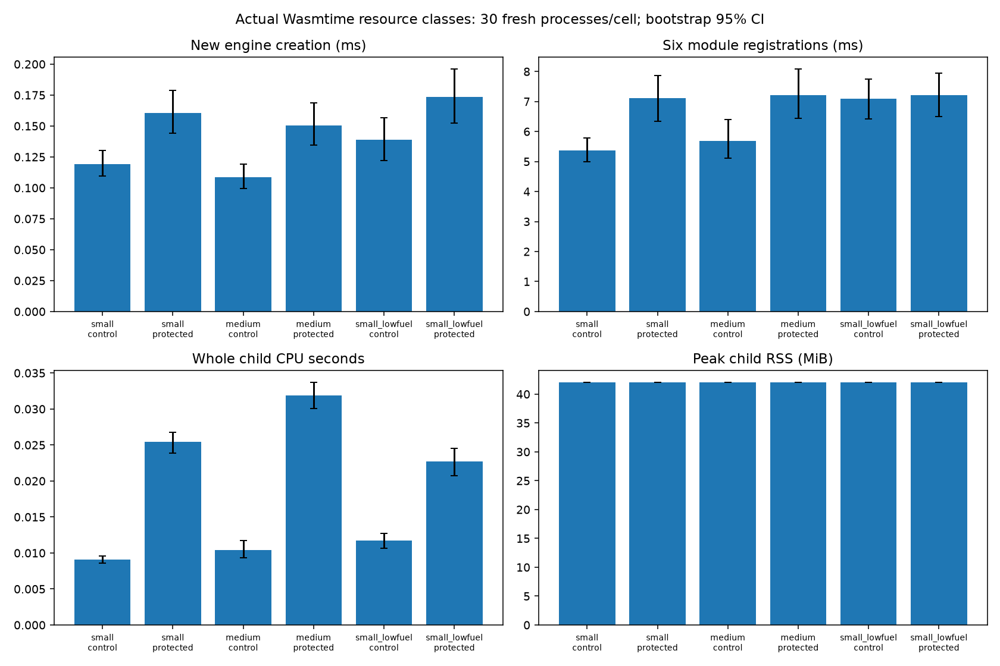
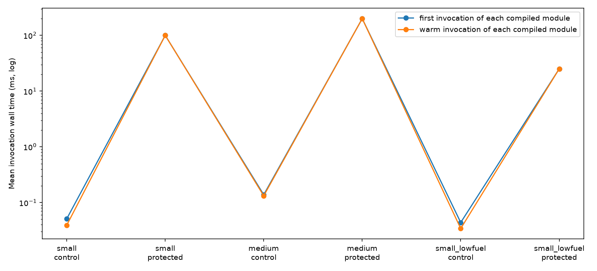
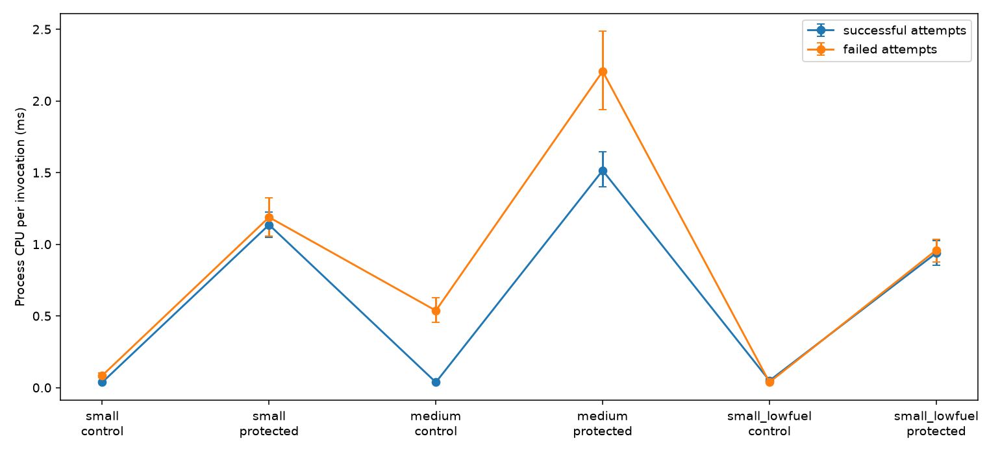

# Executor setup, first invocation and resource classes

This bounded component sweep uses actual Wasmtime through `Executor`, the five supplied WAT functions and actual in-memory Path ORAM. It addresses explicit setup/first/warm measurement and public resource-class sensitivity. It measures an ordinary trusted executor process, with no TEE. It does not establish production capacity, physical cache confidentiality, a network deadline guarantee, or deployment cost.

The fixture separately times `Executor::new` (new engine plus its epoch ticker) and each `register` (WAT parsing/compilation/registration). Each function then executes twice against its already registered module. **First** means its first invocation in that process; **warm** means its immediately repeated invocation using the same compiled module. The library creates a new Wasmtime store/guest instance per call in both cases. These measurements do not flush the OS page cache or recreate a machine, and earlier functions can warm shared runtime paths. Setup is outside invocation latency. Fresh-process loader time is included in whole-child CPU/RSS, but not in the engine timer.

There are three public class configurations, with input and output sizes fixed within each class:

| Class | Deadline | Fuel | Memory cap | Input/output bytes | Host call budget |
| --- | ---: | ---: | ---: | ---: | ---: |
| small | 100 ms | 100,000 | 65,536 | 64 | 2 |
| medium | 200 ms | 1,000,000 | 262,144 | 256 | 4 |
| small_lowfuel | 25 ms | 100 | 65,536 | 64 | 2 |

The low-fuel configuration intentionally combines a shorter deadline and lower fuel as an explicit additional class; it does not isolate their individual causal effects. Echo succeeds with 100 fuel; sum, Fibonacci, checksum and stateful functions exhaust fuel. All five succeed in small and medium. A sixth synthetic infinite-loop function exhausts fuel in every class, verifying error behavior. Memory caps vary, but these WAT functions initially use one page; this is not a memory-growth stress campaign.

Both modes use actual ORAM. `control` calls `execute_unpadded_baseline`, returning actual guest output bytes without wall-clock padding. `protected` calls scheduled `execute`, including the public full-state read/commit phases and final response padding. Protected calls return the class-fixed body size with 128 physical bucket events even on tested fuel exhaustion. This scope has plaintext library bodies, not encrypted network responses. Request/response transport, PIR, service startup and worker-pool scaling are absent.

The fixture independently computes echo, sum, Fibonacci and checksum outputs. The stateful oracle checks increments, and after every call all eight logical ORAM blocks are read and compared with the expected state. These oracle reads and serialization occur outside invocation latency and the captured invocation event count. They remain inside whole-process CPU/RSS. The oracle intentionally warms ORAM state between invocations; this is an instrumented component fixture. Low-fuel failures preserve state. All observed status/body/state mismatches cause a nonzero process exit.

Thirty fresh child processes run per class/mode cell. Trial seeds only shuffle function order; cryptographic randomness remains from the OS. Each process produces twelve invocation records: six functions × first/warm. Confidence intervals resample whole independent processes within each cell. Function/phase intervals use one call from each process; invocations are not pooled as independent samples. The two phases of each function share a process and are paired observations.

CPU comes from Linux `wait4` floating-point user and system seconds for each child. RSS is that child's `ru_maxrss` in KiB. Both include engine creation, compilation, guest calls, padding waits/ticker, ORAM setup/oracle work and serialization; they are not guest-only attribution. `total_ns - work_ns` measures only final publication padding: scheduled `work_ns` already includes public phase waits. It is not a CPU-waste estimate. No billing conversion is applied.

## Reproduction and provenance

```sh
cargo build -p oblivion-exec --example resource_measure --release
EXECUTOR_RESOURCES_BINARY="$PWD/target/release/examples/resource_measure" \
  .venv/bin/python -m unittest research.tests.test_executor_resources -v
cargo clippy -p oblivion-exec --example resource_measure -- -D warnings
.venv/bin/python -m scripts.measure_executor_resources \
  --binary target/release/examples/resource_measure \
  --config experiments/configs/executor-resources-30.json \
  --out experiments/results/executor-resources-new-run
```

The output must be new. The runner copies the binary, records source/config/binary hashes and hardware/tool versions before launching any trial, and verifies the binary hash afterward. Raw records are incrementally gzip-compressed; each completed command and its exit are retained. The local binary copy is retained for provenance but excluded from Git under the artifact binary policy. Raw data and source snapshots are bounded independently of that executable.

Two focused tests pass, including all six actual class/mode cells, expected success/fuel errors, fixed protected shapes, output/state oracles and invalid fixture arguments. The Rust example passes scoped clippy with warnings denied. No server rebuild or whole-workspace test is required for this standalone measurement fixture.

## Retained results

[Configuration](../experiments/configs/executor-resources-30.json), [prelaunch provenance](../experiments/results/executor-resources-20261023/provenance.json), [raw gzip](../experiments/results/executor-resources-20261023/raw.jsonl.gz), [180 command exits](../experiments/results/executor-resources-20261023/commands.json), [summary with whole-process bootstrap intervals](../experiments/results/executor-resources-20261023/summary.json), [verification](../experiments/results/executor-resources-20261023/verification.json), and [artifact hashes](../experiments/results/executor-resources-20261023/artifact-sha256.json) retain the campaign. All 180 processes exited zero, all 2,160 calls passed status/output/state oracles, and the immutable executable hash matched before and after launch. All 24 original artifact hashes were independently checked afterward.

| Class / mode | Engine creation mean ms | Six-module compile mean ms [95% CI] | Echo first / warm mean ms | Whole child CPU mean ms | Peak child RSS MiB |
| --- | ---: | --- | --- | ---: | ---: |
| small / control | 0.119 | 5.38 [4.99,5.78] | 0.051 / 0.026 | 9.07 | 42.02 |
| small / protected | 0.161 | 7.12 [6.34,7.88] | 100.090 / 100.072 | 25.42 | 42.02 |
| medium / control | 0.108 | 5.69 [5.12,6.41] | 0.041 / 0.024 | 10.44 | 42.02 |
| medium / protected | 0.151 | 7.22 [6.44,8.08] | 200.085 / 200.080 | 31.85 | 42.02 |
| small_lowfuel / control | 0.139 | 7.08 [6.42,7.74] | 0.064 / 0.036 | 11.69 | 42.02 |
| small_lowfuel / protected | 0.173 | 7.22 [6.50,7.96] | 25.086 / 25.085 | 22.67 | 42.02 |





The summary retains individual function/phase intervals for all 72 class/mode/function/phase combinations. The first/warm plot averages the six function means for each point; it does not claim a confidence interval for that aggregate. Protected echo latency follows the public deadline, while control echo shows a smaller warm mean. Compile time remains a separate deployment cost. There were zero `deadline_missed` work overruns; this flag compares private work completion with the deadline, so it does not assert zero publication lateness. Protected return times can exceed the target through ordinary wakeup/scheduling delay.

`wait4` peak RSS was exactly 43,032 KiB in every trial, including controls. These accounting values cannot resolve class memory differences and may include a launch/pre-exec high-water floor. They are not an estimate of guest memory allocation, physical machine memory, or production worker sizing. Whole-child CPU differences also include deployment and oracle work. Cells ran sequentially in the listed class/mode order; shared-host load and time drift limit causal comparisons across cells. Process bootstrap intervals describe this bounded run, not deployment tails.

After the campaign completed, metadata validation was strengthened without changing the measured Rust fixture or retained raw/source snapshots. A regression test first demonstrated nine previously accepted malformed setup/CPU/RSS/class values; the new validator rejects them. All three focused tests now pass, including every actual class/mode integration cell, and all 180 retained raw trials pass the strengthened validator. [Post-campaign validation](../experiments/results/executor-resources-20261023/post-campaign-validation.json) identifies those newer validator/test hashes separately; the original provenance remains the exact measured runner version.

## Invocation CPU follow-up

The original campaign's `wait4` totals are whole-process accounting and cannot identify invocation CPU. A separate campaign under `experiments/results/executor-cpu-20261023/` therefore uses schema two with explicit stage and invocation CPU counters. The original 180-process campaign remains unchanged.

The example uses the safe `cpu-time` 1.0.0 wrapper ([ProcessTime API](https://docs.rs/cpu-time/1.0.0/cpu_time/struct.ProcessTime.html), [source](https://docs.rs/cpu-time/1.0.0/src/cpu_time/lib.rs.html)), added only as an executor development dependency. On Linux, process counters use `CLOCK_PROCESS_CPUTIME_ID`; thread counters use `CLOCK_THREAD_CPUTIME_ID`. No application `unsafe` block is introduced. `try_now`/`try_elapsed` failures fail the fixture rather than silently substituting wall time.

Process CPU is measured separately around engine construction, each registration, and each actual `execute`/`execute_unpadded_baseline` call. Invocation counters include guest/host/ORAM work and any CPU consumed during padding, and exclude independent state-oracle reads, trace extraction, JSON serialization and module setup. Process CPU also includes the epoch ticker and any concurrent runtime threads in that child. A main-thread CPU counter around the same invocation helps expose that distinction. Both include clock-measurement overhead; they are not isolated guest instruction costs. Invocation wall time is still recorded independently. Public phase waits and `total_ns-work_ns` remain wall-clock quantities and are never labeled CPU waste.

The summary keeps successful calls and failed attempts separate. For each class/mode, it reports successful-attempt process/thread CPU per successful call, failed-attempt CPU per failed call, and **all invocation-attempt process CPU divided by the number of actual successful calls**. The latter charges tested fuel failures to the observed success denominator while excluding setup and oracle CPU. Small and medium have ten successes and two fuel failures per process (300 successes/60 failures per cell); low-fuel has two successes and ten fuel failures (60 successes/300 failures per cell). This is an intentionally chosen failure workload, not an estimate of production failure mix. Bootstrap intervals resample complete processes; they preserve within-process success/failure correlation. Engine and registration CPU are separate deployment-stage counters, not charged to successful invocation counts.

Four focused tests pass against the new retained executable, covering every actual class/mode cell, positive per-call CPU, broad process-CPU/wall plausibility, required schema-two counters and malformed bounds, and success/failure denominators checked against actual call records. The old executable first failed the new schema/CPU integration check. Scoped clippy passes with warnings denied.

The CPU campaign completed all 180 fresh processes and 2,160 calls with zero oracle failures. Its [prelaunch provenance](../experiments/results/executor-cpu-20261023/provenance.json), [raw records](../experiments/results/executor-cpu-20261023/raw.jsonl.gz), [command exits](../experiments/results/executor-cpu-20261023/commands.json), [CPU and stage summary](../experiments/results/executor-cpu-20261023/summary.json), [immutable-binary verification](../experiments/results/executor-cpu-20261023/verification.json), and [artifact hashes](../experiments/results/executor-cpu-20261023/artifact-sha256.json) identify this new measurement independently. All 25 recorded artifact hashes and every frozen source hash matched after completion; all 24 original campaign artifact hashes also still matched.

| Class / mode | Successes / failures | Successful process CPU ms/call [95% CI] | Failed process CPU ms/attempt | All attempt process CPU ms/success | Successful main-thread CPU ms/call |
| --- | --- | --- | ---: | ---: | ---: |
| small / control | 300 / 60 | 0.037 [0.033,0.041] | 0.085 | 0.054 | 0.037 |
| small / protected | 300 / 60 | 1.136 [1.049,1.224] | 1.188 | 1.374 | 0.696 |
| medium / control | 300 / 60 | 0.037 [0.033,0.041] | 0.537 | 0.145 | 0.037 |
| medium / protected | 300 / 60 | 1.515 [1.400,1.646] | 2.206 | 1.956 | 0.689 |
| small_lowfuel / control | 60 / 300 | 0.049 [0.035,0.063] | 0.038 | 0.238 | 0.047 |
| small_lowfuel / protected | 60 / 300 | 0.939 [0.855,1.026] | 0.959 | 5.736 | 0.811 |



All table means have whole-process bootstrap intervals in the summary; only the successful process CPU interval is expanded in the table. Protected process CPU includes ticker work during the public waits, explaining why it can exceed main-thread CPU. The low-fuel all-attempts-per-success value reflects its deliberately high failure fraction. These numbers measure this execution component's actual CPU, not the wall-clock padding interval, an ORAM/PIR/full-service layer decomposition, guest-only CPU, or production CPU cost. The minimum recorded invocation process CPU was 10,181 ns. Engine creation and six registration stages have independent CPU measurements in the same summary.
