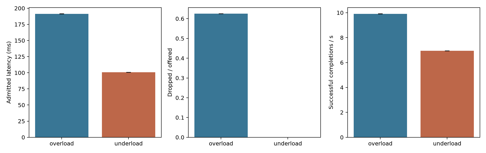
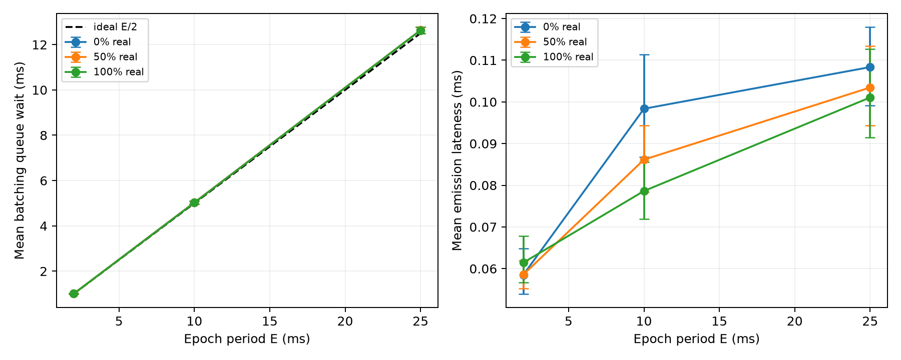

# Runtime offered load and batching measurements

Measured on 21 October 2026 using release binaries on a shared Linux host. The two experiments answer different questions: the process experiment measures actual offered-load admission and execution, and the batching experiment measures the real `EpochBatcher` component using OS timers. Neither experiment establishes statistical indistinguishability, active-attack availability, TEE isolation or independent PIR operators.

## Reproduce and inspect

Configuration: [`runtime-sweeps-30.json`](../experiments/configs/runtime-sweeps-30.json). Runner: [`benchmark_open_loop.py`](../scripts/benchmark_open_loop.py). Analysis: [`research.analysis.open_loop`](../research/analysis/open_loop.py).

Commands executed from the repository root:

```sh
.venv/bin/python scripts/benchmark_open_loop.py experiments/configs/runtime-sweeps-30.json --mode runtime
.venv/bin/python scripts/benchmark_open_loop.py experiments/configs/runtime-sweeps-30.json --mode copy --skip-build
.venv/bin/python scripts/benchmark_open_loop.py experiments/configs/runtime-sweeps-30.json --mode batch --skip-build
cargo test -p oblivion-batcher --all-targets
cargo clippy -p oblivion-batcher --all-targets -- -D warnings
```

The runtime runner builds `oblivion-server` with `cargo build --locked --release -p oblivion-server`. The batch example was built with `cargo build --locked --release -p oblivion-batcher --example batch_measure`; `--skip-build` reused that validated binary. Each experiment copies its executable into its own `bin` directory, hashes that immutable copy before launching any trial, hashes it again after the last trial and preserves exact per-trial commands. Parent builds cannot replace that copy. Metadata also records the Rust/compiler version, host/CPU, git status, complete crate source digest, runner/analysis/config digests, workload seed and shared-host/no-affinity policy.

For a fresh reproduction, use new destinations because the runner never overwrites raw trial directories:

```sh
.venv/bin/python scripts/benchmark_open_loop.py experiments/configs/runtime-sweeps-30.json --mode runtime --runtime-output /tmp/runtime-new
.venv/bin/python scripts/benchmark_open_loop.py experiments/configs/runtime-sweeps-30.json --mode batch --batch-output /tmp/batch-new
```

Regenerate summaries and figures solely from retained raw artifacts:

```sh
.venv/bin/python -m research.analysis.open_loop --runtime experiments/results/runtime-open-loop-current --batch experiments/results/batch-epoch-current
```

NumPy and Matplotlib versions and the analysis source digest are recorded in each `analysis-provenance.json`. The plots use 5,000 bootstrap resamples with a fixed analysis seed. The independent sampling unit is a whole fresh-process trial, with equal weight per trial. Per-message observations from one trial are never treated as independent trials. Error bars are percentile 95% intervals for trial means; they are not prediction intervals for future tail latency.

## Actual process offered load

[`runtime-open-loop-current`](../experiments/results/runtime-open-loop-current/) contains 30 fresh-process trials at each profile, shuffled in a seeded order: eight offers spaced by 150 ms (underload) or 10 ms (overload), queue capacity two. A producer thread schedules arrivals independently and uses bounded `try_send`; the consumer performs actual authenticated envelope exchange, two encrypted PIR process requests, stateful Wasmtime execution and sixteen actual ORAM operations per admitted request. Every admitted successful counter is checked against a client oracle. All 60 processes exited successfully, with zero authenticated invocation errors and zero recorded execution deadline misses.

| Profile | Admitted / offered | Dropped | Mean admitted E2E ms (95% interval) | Mean trial p50 / p95 / p99 ms | Successful completions/s | Offered SLO failure fraction |
| --- | --- | --- | --- | --- | --- | --- |
| Underload | 8 / 8 | 0% | 100.641 [100.614, 100.673] | 100.614 / 100.879 / 100.931 | 6.950 | 0% |
| Overload | 3 / 8 | 62.5% | 191.411 [191.328, 191.503] | 191.403 / 273.174 / 280.442 | 9.913 | 75% |

SLO is 250 ms from actual offered time to completion. Its failure fraction includes dropped offers and invocation errors. Latency quantiles describe admitted requests only. Each trial has only eight offers (three admitted under overload); its p99 is an interpolation near its maximum, not a well-resolved population p99. The table averages those trial quantiles and does not present them as a large-sample tail guarantee. The overload pattern was identical across all 30 trials, producing degenerate drop/SLO bootstrap intervals; this is a finite workload observation, not certainty about other loads.

Mean queue wait was 0.060 ms underload and 90.855 ms overload. Mean service time remained 100.580 and 100.556 ms. Underload throughput includes the deliberate 150 ms arrival spacing and last-response drain, so it does not measure saturation capacity. Actual arrival timing and producer lateness remain in every `offered-arrivals.jsonl`; mean per-trial p99 producer lateness was 0.224 ms underload and 0.162 ms overload.



Fresh process first invocation service means were 100.568 ms underload and 100.552 ms overload; subsequent admitted service means were 100.582 and 100.558 ms. WASM was precompiled before readiness. These measurements compare first and subsequent invocations in a padded class, not cold compilation or function-specific cold start latency. Complete process wall time, including metadata collection, provisioning, precompilation and teardown, averaged 1200.115 ms underload and 352.292 ms overload; the raw launch record preserves that separate measurement.

Observed CPU ticks averaged 4.733 per underload trial and 0.667 per overload trial at 100 ticks/second. Their numerically converted means are 47.333 ms and 6.667 ms. These are coarse deltas of per-process `/proc` counters for driver, executor and both PIR children. Individual fields are quantized, so small per-trial totals and sub-tick means across trials are not high-resolution CPU measurements. Startup/teardown CPU is excluded. Sampled aggregate peak RSS averaged 25.954 and 25.913 MiB; snapshots may miss peaks and count shared pages multiple times. No cloud-price or billing conclusion is drawn from these measurements.

Provenance binary SHA-256: `4dae6df91b8f056957a3d0b7b892696cc50677546ea9df79e45ce81cafab2ef8`, unchanged after all 60 trials. Source digest at launch: `bb2f07dfc4910d48aa6f8ab190d9c5b3ca7bece18eab20eeb5d02a8c7a16ee3b`.

Admission and drop timing deliberately reveal demand. This benchmark command has no constant-cover claim and does not use the demo's fixed epoch batcher. Its queue and worker state are ephemeral; acknowledgments are not durable commits. Scheduling, CPU contention, backend failure and active denial of service can change the observed behavior. See [runtime failure policy](RUNTIME_INTEGRATION.md).

## Fixed epoch batching component

The [`batch_measure` example](../crates/oblivion-batcher/examples/batch_measure.rs) constructs actual OS-keyed authenticated endpoints and calls `EpochBatcher::submit` and `emit` on a real monotonic timer. Each fresh process has eight clients, 32 epochs and seeded uniform planned arrival phases within each epoch. Periods are 2, 10 and 25 ms. Each period is measured at 0%, 50% and 100% real payloads, with 30 independent process trials per cell: 270 trials and 69,120 encrypted client frames total. Every batch is checked to have eight fixed 164-byte frames; emitted frames are actually authenticated/decrypted to count real and dummy payloads. At 0%, 50% and 100%, dummy counts are respectively 256, 128 and zero per process.

There is no simulated WASM, PIR or ORAM processing in this component experiment. `raw.jsonl` records planned and actual admission times, actual emit-return time, per-client queue wait, producer lateness, public batch sizes, dummy counts and emission deadline lateness. The real/dummy labels are experiment ground truth, not proposed untrusted observer features. Rows are written after measurement to keep file output off the timed path. Encryption, authentication checks, allocations, prior-epoch work and OS scheduling can still affect actual arrival phases and timing.

The ideal E/2 line assumes continuous uniform actual arrivals and punctual epoch boundaries. This experiment seeds uniform *planned* phases and reports the actual timing error; it neither calibrates an external clock nor guarantees that the host sleeps to an exact nanosecond. Shared-host interference remains possible. Matching trial seeds across periods and real ratios provide common random numbers, so cells are paired rather than independent experiments for cross-cell inference.

All 270 batching processes exited successfully. Trial-mean queue wait and its bootstrap 95% interval were:

| Epoch ms | Real load | Mean queue wait ms | 95% interval | Mean emission lateness ms |
| --- | --- | --- | --- | --- |
| 2 | 0% | 1.005 | [0.994, 1.015] | 0.059 |
| 2 | 50% | 1.006 | [0.995, 1.017] | 0.059 |
| 2 | 100% | 1.008 | [0.996, 1.019] | 0.061 |
| 10 | 0% | 5.033 | [4.967, 5.098] | 0.098 |
| 10 | 50% | 5.027 | [4.960, 5.092] | 0.086 |
| 10 | 100% | 5.021 | [4.955, 5.089] | 0.079 |
| 25 | 0% | 12.636 | [12.489, 12.775] | 0.108 |
| 25 | 50% | 12.635 | [12.487, 12.775] | 0.103 |
| 25 | 100% | 12.631 | [12.483, 12.774] | 0.101 |



The standalone [PDF figure](../experiments/results/batch-epoch-current/batching-overhead-vs-epoch.pdf) is regenerated by the same analysis command. Curves show trial means with trial-level intervals; the dashed curve is the ideal reference. Similar batch shape and queue-time means at the three real ratios do not establish indistinguishability against a classifier or active attacker.

Batch binary SHA-256: `b18e9358265d4a8557d9f76c0e7f65c999c40088f99bc8a8ceebaf80c2f05a23`, unchanged after all 270 trials. The complete crate-tree digest changed while measurements ran because the shared workspace remained active; both before/after digests are retained. The measured executable was an immutable copy throughout. Its launch source digest identifies the workspace snapshot at launch and does not assert that the final shared working tree matches that binary. Shared-host activity can also affect timing; no CPU isolation or external-clock exactness is claimed.

The first attempted `cargo run -p oblivion-batcher --example batch_measure ...` failed because the example did not exist. After implementation, its actual-timer/authentication test passed, then `cargo test -p oblivion-batcher --all-targets` passed the six existing integration tests and the new example test. Scoped clippy passed with warnings denied. The analysis validated every trial's arrival/frame counts, dummy counts, batch sizes, runtime admission accounting and actual ORAM event counts before producing the figures. Process return codes and stderr remain in each experiment's `launches.json`; no failed trials were discarded from either completed sweep.

## Preserved four-client matrix

[`runtime-matrix-current`](../experiments/results/runtime-matrix-current/) is a byte-preserving copy of the previously validated `demo-sse` four-client 0%, 50%, 100% matrix from `/tmp/oblivion-runtime-validation-txlc0y4w`. The copy records a SHA-256 digest for every original file and verifies the destination against those digests; `copy-provenance.json` records the source, destination, copy time and runner digest. Original metadata is retained verbatim. This is preservation of a historical validated run, not a new execution or a retroactive binary-hash assertion.

The matrix has 32 actual invocations and 32 oracle-verified metadata searches per load; real/dummy totals are 0/32, 16/16 and 32/0. The half/full profiles verify all five real functions. Each original summary reports registry version 1 and deployment digest `de0d3a483eee0609030ee60cce3f8de2cef5731decb9475387af8bae777dedc5`. See [integration scope and limitations](RUNTIME_INTEGRATION.md) for the process simulation and discovery trust boundaries.
