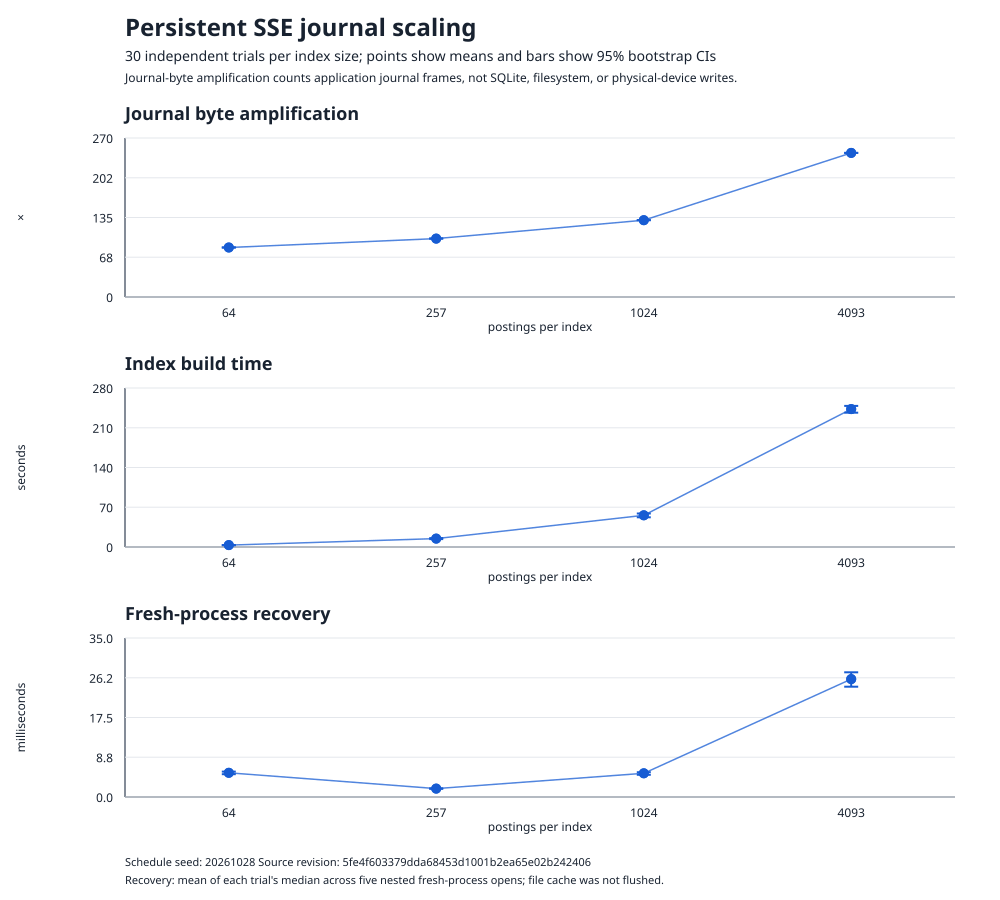

# Persistent SSE journal benchmark result (2026-10-28)

## Scope and provenance

This report records the execution of the frozen method in
[SSE_JOURNAL_BENCHMARK_20261028.md](SSE_JOURNAL_BENCHMARK_20261028.md).
The runner was built from source revision
`5fe4f603379dda68453d1001b2ea65e02b242406` (`0.1.0`); its report records a
clean tracked source tree. The configuration used 30 trials at each of four
index sizes and five fresh-process reopens per index. The schedule seed was
`20261028`.

The collector used the real local Unix anchor service backed by SQLite. Every
trial built an index of distinct deterministic keyword/document-ID postings.
The report records each persistent-client prepare/finish update, server insert,
journal frame byte count, checkpoint generation, and recovery open. Production
cryptographic keys, index IDs, nonces, and run namespace came from the OS CSPRNG.
The full run completed in about 2 hours 54 minutes on Linux, an Intel Core
i7-14650HX with 24 logical CPUs, using `rustc 1.99.1`.

## Results

Each interval below is a 95% percentile bootstrap interval over 30
trial-level observations, using 5,000 resamples. Recovery intervals use each
trial's median across five nested fresh-process opens, so the five opens are
not counted as independent trials.

| Index postings | Journal frame bytes written, mean [95% CI] | Application journal-byte amplification, mean [95% CI] | Index build time, mean [95% CI] | Fresh-process recovery open, mean trial median [95% CI] |
| ---: | ---: | ---: | ---: | ---: |
| 64 | 182,865 [182,620, 183,093] B | 84.037 [83.926, 84.146]× | 3.316 [3.062, 3.508] s | 5.319 [5.025, 5.585] ms |
| 257 | 867,026 [865,949, 868,106] B | 99.225 [99.099, 99.345]× | 14.756 [13.958, 15.628] s | 1.848 [1.800, 1.902] ms |
| 1,024 | 4,543,107 [4,538,705, 4,547,388] B | 130.489 [130.357, 130.612]× | 55.836 [52.255, 59.056] s | 5.213 [4.897, 5.459] ms |
| 4,093 | 34,060,514 [34,040,567, 34,081,308] B | 244.754 [244.612, 244.903]× | 242.889 [236.512, 248.565] s | 25.963 [24.275, 27.454] ms |

The 4,093-posting indexes used 139,162 logical input bytes and wrote a mean
34,060,514 bytes of encrypted journal frames, including the initial checkpoint
and records later removed by checkpoint pruning. Index-build p50/p95/p99 were
248.901/264.817/265.837 seconds at that size. The complete report contains
p50/p95/p99 and 5,000-bootstrap metadata for all recorded metrics.

The measured journal bytes per logical byte increased from about 84× to 245×
over the tested sizes. Mean index-build time also increased substantially. The
recovery means are not monotonic at the smaller sizes; these measurements do
not establish a general recovery scaling law.



## Interpretation limits

“Journal-byte amplification” is the sum of encrypted application journal frame
file lengths divided by logical keyword-plus-document-ID bytes. It is **not**
physical device write amplification, filesystem write amplification, SQLite
page writes, or SQLite/WAL amplification. The benchmark does not instrument
block-device writes or storage-controller behavior.

Recovery starts a new OS process, but the host page cache is not flushed. These
are process-restart measurements with a potentially warm file cache, not
cold-storage recovery. The local Unix service runs on the same host; process
separation does not establish an independent anchor operator or protect the
anchor database from a privileged host rollback. The report captures CPU model,
logical CPU count, OS, and Rust compiler, but not a collection-time CPU
affinity or load-average snapshot. The timings are specific to this local host
and configuration.

The run measures storage and recovery costs only. It does not add anti-rollback
protection, prove forward/backward privacy, or measure the system's full
network-visible behavior. The persistent SSE construction remains constrained
GGM-inspired and does not claim a faithful Diana implementation or backward
privacy.

The independent verifier recomputes trial coverage, generation and byte
invariants, recovery process counts, and all descriptive means/quantiles from
the raw per-trial observations. It checks that bootstrap intervals are finite,
ordered, and carry the expected seeds and replicate counts; it does not
reproduce the runner's exact Rust `StdRng` resampling stream.

## Retained artifacts and reproduction

The exact configuration, 8 MB raw JSON report, standalone SVG, and their
SHA-256 manifest are in
[`experiments/results/sse-persistent-journal-benchmark-20261028/`](../experiments/results/sse-persistent-journal-benchmark-20261028/).
The verifier and plot generator use only Python's standard library:

```sh
python3 research/analysis/verify_sse_journal_benchmark.py \
  experiments/results/sse-persistent-journal-benchmark-20261028/report.json \
  experiments/configs/sse-persistent-journal-benchmark-20261028.json \
  --expected-revision 5fe4f603379dda68453d1001b2ea65e02b242406

python3 research/analysis/plot_sse_journal_benchmark.py \
  experiments/results/sse-persistent-journal-benchmark-20261028/report.json \
  experiments/configs/sse-persistent-journal-benchmark-20261028.json \
  experiments/results/sse-persistent-journal-benchmark-20261028/journal-scaling.svg \
  --expected-revision 5fe4f603379dda68453d1001b2ea65e02b242406

(cd experiments/results/sse-persistent-journal-benchmark-20261028 && sha256sum -c SHA256SUMS)
```

The original collection command and exact host-side setup remain in the
[preregistration](SSE_JOURNAL_BENCHMARK_20261028.md).
