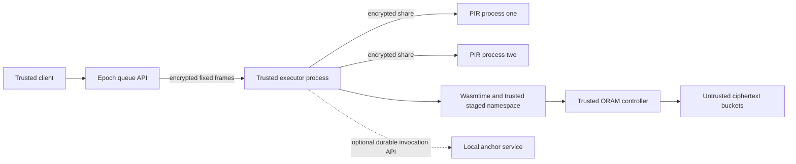

# Threat model: TrustedExecutor

Updated 2026-10-22. Scope: the implemented research prototype and separately measured research components. This is a concrete instance of the roadmap's Model A, with the executor trust boundary **simulated by ordinary processes**. There is no hardware TEE, attestation or cryptographic audit.

## Goal and system

Protect module selection, invocation payloads and logical state addresses at defined interfaces, and measure residual inference from observable patterns. The client and executor are trusted. Storage ciphertext, transport, batching and scheduling are untrusted. The executor sees selected modules, plaintext inputs/outputs, logical addresses and all private instrumentation.

The queue and client share a parent process; separate APIs are not separate OS security principals. Each PIR worker owns a separate database/session but shares the same host. Inherited setup pipes assume a trusted kernel. A host administrator can inspect every process, keys and pipe: protecting against it requires hardware/system work outside the implementation. A malicious backend implementation executing arbitrary Rust inside the executor also violates the modeled boundary.

The demo enrolls one to four clients, executes all five functions in mixed mode, uses distinct real/dummy namespaces and keeps live state in encrypted memory buckets. When both anchor environment variables are configured, the executor can restore its ORAM state from an encrypted full-store checkpoint and atomically commit each signed invocation response with the next checkpoint. `oblivion-anchor serve` provides a local Unix-socket service; it should run under a separate OS account with separately provisioned master-key custody. The service remains on the same host, and root can inspect its process, key and socket data. SSE is an ephemeral append-only component; the reference PIR comparison and autoscaler simulator are independent experiments.

## Assets and adversary

| Asset | Objective and limit |
| --- | --- |
| Function/code selection and invocation identity | Conceal registry target from each non-colluding PIR server and real/dummy labels inside invocation ciphertext; executor knows selection |
| Inputs, outputs, modules and state | Confidentiality at encrypted interfaces; integrity of accepted pinned registry records and buckets |
| Client/executor keys, maps, stash, versions and staging | Remain inside trusted boundary; private instrumentation cannot be released to the observer |
| Keyword/document metadata | SSE encrypts immutable IDs and prevents old capabilities from deriving future posting leaves under stated assumptions; equality/volume/timing remain visible |
| Persistent state | Recover against the latest checkpoint handle and replay the exact response for a signed invocation ID; rolling back the entire SQLite database remains possible, and there is no exactly-once claim for external side effects |

The adversary knows source, algorithms, public dimensions, classes, schedules and defenses. It may persistently observe network endpoints, frame sizes/times, storage paths/times, public slots/epochs, startup, scaling events and available resource/billing signals. It may modify, replay, reorder, duplicate, delay or drop messages and storage ciphertext. Availability is a non-goal.

**PIR non-collusion is essential.** Each XOR server sees its own random vector. Both vectors reveal the selected index. AEAD on both links prevents a network-only observer without endpoint keys from combining decrypted shares. Separate local workers do not establish organizational non-collusion. The intentionally plaintext loopback tool is only an individual-server-view component experiment.

## Mechanisms and leakage functions

For public configuration C and workload W, the modeled joint leakage includes:

`L(C,W) = (setup dimensions, endpoints, frame lengths/times, PIR activity, ORAM paths/times, public classes, slots/epochs/participation, startup, capacity/cold starts, available resources/billing, failure behavior)`.

| Phase | Mechanism | Residual leakage |
| --- | --- | --- |
| Setup | Fresh OS keys, directional HKDF, private provisioning pipes, bounded trusted module loading | Tree/registry dimensions, deployment, code within trusted executor, participants and public class |
| Invocation | Fixed 228-byte v2 directional AEAD, epoch/slot binding, signed canonical request identity, optional atomic response/checkpoint receipts | Endpoints, version/direction/epoch/slot, timing, connection/participation, receipt hit/miss at the anchor, active failures |
| PIR | Encrypted random shares, geometry-bound frames and full scans; pinned record checking in pipeline | Dimensions, activity and timing; target under collusion; generic API needs application authenticity |
| Storage | AEAD fixed buckets, location/version binding, full path remap/read/write | Paths, counts, phase timing, failures and maintenance; controller is not constant-time |
| Execution | Fuel/memory/call limits, no WASI, fixed I/O/deadline, trusted staged working set and namespaces | Public resource class, scheduler/cache/resource behavior, overruns and failures |
| SSE update | Fixed-size random-looking address and encrypted ID, exact retry bytes | Timing/order, storage growth, client identity, retry equality; workload correlations |
| SSE search | Exact prefix constraints and checked encrypted postings | Stable search tag, equality, counts/cover size, accessed historical postings, timing; later search links matching updates |
| Recovery | Authenticated full snapshot, secret latest handle, validate then rekey/restore | Full-tree maintenance, snapshot size/generation; rollback if handle and snapshot both roll back |
| Scaling simulation | Five declared policies, restricted public count/event observer | Model-specific capacity/cold-start inference; broader runtime queues/traffic/billing not evaluated by that observer |

The protected small class stages eight blocks. It reads all eight through ORAM at the public quarter-deadline boundary, then writes all eight at half deadline, using the original snapshot on guest failure. Successful-backend traces therefore have 16 logical ORAM operations and fixed bucket lengths. This costs O(M log N) bandwidth. Late work and active backend failures can break timing/trace shape; schedule engineering does not prove full-system privacy. Guest traps do not commit staged mutations, but interrupted physical commits can partially modify storage and invalidate the controller.

The trusted driver's publication boundary includes response AEAD and instrumentation preparation: `prepare_scheduled` returns private execution results after the public read/commit phases, then the driver prepares the ciphertext/logs before waiting until the 100 ms response deadline. The standalone `execute_scheduled` API still pads its own return. Client encrypted frames are prepared before public epoch emission, and server slots use epoch-arrival plus slot-index × 100 ms origins so serialization jitter does not accumulate across slots. Driver work overruns and observed publication lateness are distinct private diagnostics; any shared-host timer can wake late.

## Freshness and restart

Live bucket versions, nonce counters and protocol epochs reject tested replay/substitution. File buckets alone do not encode a trusted controller. Full checkpoints include keys, position map, stash, versions/counters and buckets; restore authenticates against a secret trusted handle and always rotates bucket keys before encryption.

`PathOram::checkpoint_anchored` enforces the snapshot-then-anchor-CAS ordering for a snapshot ID and secret handle through a caller-provided `CheckpointAnchor` adapter. The durable worker mode commits each signed request's checkpoint handle and fixed-size response atomically through the SQLite-backed local service. It restores the latest snapshot after process restart, but the database operator and separately provisioned key must remain trusted; restoring an old database backup can roll back both receipts and state. Durable misses perform visible full-tree snapshot reads/writes; receipt hits run the dummy cover function but skip checkpoint creation, so the trusted anchor operator can distinguish them. The worker acknowledges successful durable operations only after anchor publication. Unique immutable snapshot IDs prevent accidental overwrite; stale/mixed/corrupt images fail authentication. Fresh keys after restore avoid restoring an old nonce domain. Invocation session roots/epochs and ephemeral SSE counters have no supported restore API. Same-ID concurrency and arbitrary side effects remain outside the transaction. See [STORAGE_RECOVERY.md](STORAGE_RECOVERY.md), [ANCHOR_SERVICE.md](ANCHOR_SERVICE.md), and [INVOCATION_DURABILITY.md](INVOCATION_DURABILITY.md).
`PathOram::checkpoint_anchored` enforces the snapshot-then-anchor-CAS ordering for a snapshot ID and secret handle through a caller-provided `CheckpointAnchor` adapter. The durable worker mode commits each signed request's checkpoint handle and fixed-size response atomically through the SQLite-backed local service. It restores the latest snapshot after process restart, but the database operator and separately provisioned key must remain trusted; restoring an old database backup can roll back both receipts and state. Durable misses perform visible full-tree snapshot reads/writes; receipt hits run the dummy cover function but skip checkpoint creation, so the trusted anchor operator can distinguish them. The worker acknowledges successful durable operations only after anchor publication. A same-host advisory lock allows one cooperating worker per invocation slot before readiness; raw protocol/database callers and other hosts can bypass it. Unique immutable snapshot IDs prevent accidental overwrite; stale/mixed/corrupt images fail authentication. Fresh keys after restore avoid restoring an old nonce domain. Invocation session roots/epochs and ephemeral SSE counters have no supported restore API. Arbitrary external side effects remain outside the transaction. See [STORAGE_RECOVERY.md](STORAGE_RECOVERY.md), [ANCHOR_SERVICE.md](ANCHOR_SERVICE.md), and [INVOCATION_DURABILITY.md](INVOCATION_DURABILITY.md).

## Evidence and abuse paths

| Risk | Existing checks | Remaining scope |
| --- | --- | --- |
| Host reads executor or both PIR workers | Explicit TrustedExecutor/non-collusion assumptions | Real hardware isolation, attestation and independently operated servers |
| Storage replay/corruption or partial writes | AEAD/version/placement checks, poison on uncertainty, checkpoint stale/mixed/truncation tests, local atomic CAS service | External service deployment/crash campaign; whole-database rollback and durable acknowledgments |
| Concurrent durable workers for one local state slot | Exclusive per-slot OS lock held before checkpoint restore/readiness through the cooperating Unix client API; anchor CAS still rejects stale generations | Raw protocol/direct database callers can bypass the cooperative lock; separate hosts do not share it; host root or an untrusted socket parent can replace lock state |
| Guest-specific count/timing inference | Fixed staged working set, namespaces, uniform class bodies and scheduled read/commit phases | Completed bounded joint/eight-class classifiers; stronger full-trace inference, deadlines under broad load, cache/resource/billing and active-failure leakage |
| Cross-client or dummy state access | Bounded trusted namespace mapping and reserved state tests | Broader multi-tenant deployment and application policy |
| Malicious registry answer or stale publisher-signed catalog | Worker verifies the pinned publisher signature and embedded module bindings; when configured, a digest-bound local SQLite CAS rejects rollback/equivocation before readiness | Key-to-publisher binding; restoring an old anchor database defeats freshness; host root can replace local state; no hardware freshness source, remote publication or partial-catalog inclusion proofs |
| Slow/dead peer or malformed frames | Bounded geometry, authenticated sequence/epoch, TCP deadlines and component failure tests | Complete process/fault campaigns and synchronous I/O/lock bounds |
| SSE future-update linking | Exact GGM prefix covers, all retained-capability test and deliberately leaky controls | Bounded count/likelihood/iterative/chosen-update evidence exists; realistic drift, persistence/state-loss protocol and broader compositional metadata attacks remain |
| Statistical overclaim or target-label leakage | Separate observer/truth, independent profiling sessions, trial-cluster uncertainty | Stronger attacks and realistic licensed workloads |

Recorded evidence is in [IMPLEMENTATION_STATUS.md](IMPLEMENTATION_STATUS.md) and [REQUIREMENTS_MATRIX.md](REQUIREMENTS_MATRIX.md). The historical 30-trial component results concern frequency tags and a size/latency stump. Final [joint A–G evaluation](SYSTEM_EXPERIMENTS.md) uses declared summary features across actual library interfaces; [execution/error inference](EXECUTION_EVALUATION.md) and [bounded SSE inference](ADVANCED_ATTACKS.md) have separate controls and observation contracts. None covers every host or physical-channel observation. The SSE capability challenge is a narrow regression adversary. The autoscaler observer excludes direct queue and request visibility, so its scores apply only to that contract. Near-chance results cannot establish zero leakage.

## Non-goals and open issues

No global indistinguishability, production security, backward privacy, formal DP, hardware confidentiality, availability, constant-time execution or complete active-security theorem is claimed. Presence/intersection, cold starts, exposed billing/resources, caches/page faults, scheduler correlation, deadline misses and partial failure traces remain. Fixed batching does not conceal a client going offline. Current and historical source/result evidence must remain distinct; bounded A–G attacks/ablations and the local demo recording now exist, while realistic-data, presence/intersection, broad benchmark/fault sweeps and final frozen-source/hosted acceptance remain tracked work.
